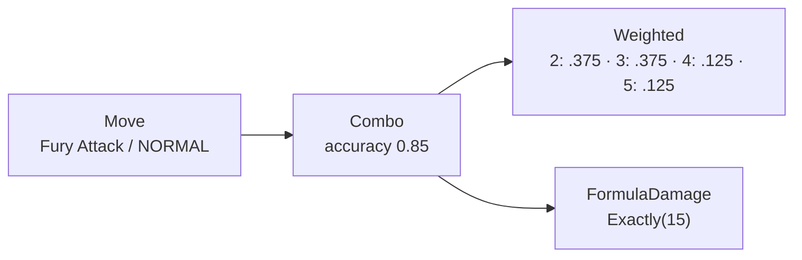

# Context

This repository is a terminal Pokémon battle built to answer one question: what does a
battle system look like when every source of variation is an object instead of a branch?

It follows Christopher Okhravi's two videos:

1. [Rebuilding Pokémon with Object Oriented Programming](https://www.youtube.com/watch?v=CyRtTwKeulE)
   builds the DSL: moves, attempts, effects, conditions, numbers, targets.
2. [Accidentally Used Design Patterns When Rebuilding Pokémon](https://www.youtube.com/watch?v=f_0TFCNvCC4)
   names the patterns that design turned out to use.

The companion book is *The Object Oriented Way*. Transcripts of both videos, with the
whiteboard diagrams reconstructed, are in
[TRANSCRIPT-01-rebuilding-pokemon-with-oop.md](TRANSCRIPT-01-rebuilding-pokemon-with-oop.md)
and
[TRANSCRIPT-02-accidentally-used-design-patterns.md](TRANSCRIPT-02-accidentally-used-design-patterns.md).

The project is an implementation, not a reproduction: the DSL is faithful, while the
roster, type chart, status rules and battle loop are additions needed to make it playable.

## At a glance

| | |
|---|---|
| Language | Java 27 |
| Build | Maven (`pom.xml`), executable JAR |
| Entry point | `com.pokemon.Main` |
| Data | `src/main/resources/pokemon.csv` |
| Dependencies | none at runtime; JUnit 5 is `test`-scoped |
| Tests | 14 JUnit 5 classes, 84 tests (`mvn test`); the battle loop is still the integration test |

## Build and run

```powershell
mvn -q clean package
java -jar target/PokemonOOP-1.0-SNAPSHOT.jar
```

The JAR is Java 27 bytecode (`maven.compiler.release=27`); run it with Java 27 or newer.
If `java` on `PATH` is an older JRE, use the JDK that Maven used:

```powershell
& "$env:JAVA_HOME\bin\java" -jar target/PokemonOOP-1.0-SNAPSHOT.jar
```

`mvn -q compile` is enough to check that a change compiles. The program is interactive:
pick a Pokémon by number, then pick a move by number each turn.

## What the program does

1. `Main` loads the roster from `pokemon.csv` through `PokemonLoader`.
2. The player chooses 1v1 or 2v2, then picks one or two Pokémon; the CPU picks a
   distinct team of the same size at random.
3. `BattleEngine` runs rounds over each side's `Party`. The faster battler acts first.
4. Before acting, sleep, freeze and paralysis are checked; each can skip the turn.
5. The chosen `IMove` is executed with a `Battle` holding attacker and defender.
6. After the move, burn, poison and badly-poison damage is applied to the attacker.
7. The player may switch voluntarily; a switch resolves before either move.
8. When an active Pokémon faints and its party has a healthy bench member, that
   member replaces it. The battle ends only when a whole party has fainted.

Everything between steps 4 and 6 is the DSL. The engine only decides *when* to call
`execute`; the move decides *what happens*.

## The six interfaces

| Interface | Method | Role |
|---|---|---|
| `IMove` | `execute(Battle)` | A complete move: name, element, mechanics. |
| `IAttempt` | `execute(Battle)` | The hit/miss machinery. Leaf or chain. |
| `IEffect` | `apply(Battle)` | A state change: damage, status, heal, faint. |
| `ICondition<T>` | `check(T)` | A predicate over a battle, a battler, or a number. |
| `INumber` | `evaluate(Battle)` | A `double` that is computed, not stored. |
| `ITarget` | `resolve(Battle)` | Picks a `Battler` (attacker or defender). |

They live in `com.pokemon.api`. Implementations live in `moves`, `attempts`, `effects`,
`conditions`, `numbers` and `targets`; `battle` and `data` hold state and wiring.

| Package | Contents |
|---|---|
| `battle` | `Battle` (turn state), `Party` (active/bench), `Battler` (stats, status, moves), `TurnOrder`, `Element`, `Weather` |
| `moves` | `Move` leaf and the two `IMove` decorators |
| `attempts` | `Attempt` leaf, `Cascade`, `Combo` |
| `effects` | damage, status, healing, `Sequence`, `ConditionalEffect`, `NoEffect` |
| `conditions` | logical, probabilistic, numeric, battler predicates, `For` |
| `numbers` | constants, ranges, weighted dice, arithmetic, battle readouts |
| `targets` | `Attacker`, `Defender` |
| `data` | `MoveRegistry`, `PokemonLoader`, `TypeChart` |

## Composition instead of configuration

There is no `switch` on move names anywhere. `MoveRegistry` maps a key to an object graph
built from the same handful of types, and `pokemon.csv` refers to moves by key.

A leaf move is three objects:

```text
Move("Tackle", NORMAL)
└── Attempt(95%, FormulaDamage(Exactly(40)))
```

Fury Attack is the video's showcase: one accuracy roll, a weighted hit count, and one
effect repeated per hit.



| Move | Shape | Idea |
|---|---|---|
| Tackle | `Move → Attempt` | The leaf case. |
| Triple Kick | `Move → Cascade(3 × Attempt)` | Each hit rolls; a miss stops the chain. |
| Body Slam | `Move → Attempt → Sequence(damage, ConditionalEffect(30%, Paralysis))` | Effects compose into a tree. |
| Fury Attack | `Move → Combo(accuracy, Weighted, damage)` | The hit count is an `INumber`, resolved lazily. |
| Thunder Wave | `WithApplicability(WithPrecondition(Move))` | The video's order; the code nests the two the other way (see Fidelity notes). |

## Design-pattern audit

This is the answer to "did I implement the second video correctly?". At the type level,
yes. Each pattern is present in the shape the video describes; the one semantic slip is
the decorator order in two moves (see below).

| Pattern | Where it lives | Verdict |
|---|---|---|
| **Strategy** | `INumber` (`FormulaDamage` does not know which number it gets), `IEffect` (`Attempt` does not know which effect), `ICondition` (`Probability` as accuracy, `HasElement` as applicability) | Correct. Families of interchangeable algorithms behind one method. |
| **Composite** | `Sum` / `Product` / `Quotient`, `Sequence` / `ConditionalEffect`, `And` / `Or` / `Not`, `Cascade` / `Combo` | Correct. A composite implements the same interface it contains, so leaves and trees are used uniformly. |
| **Decorator** | `WithPrecondition`, `WithApplicability` | Correct shape: same `IMove` interface, exactly one wrapped component. Order is wrong in two moves. |
| **Command** | `IMove` is the command, `Battle` the receiver, `Battler` holds the commands, `BattleEngine` calls `execute` | Correct, with the video's own nuance: the holder and the caller are split across `Battler` and `BattleEngine`. |
| **Null Object** | `NoEffect` as the default `onMiss` / `after` effect, and as the default `onFail` branch | Correct. Effect slots are never null and callers never special-case "nothing". |

### Strategy and Composite in one sentence each

`FormulaDamage` takes an `INumber power`; whether that is `Exactly(90)`, `MaxHP(target)`,
or `Sum(a, b)` is invisible to it. `Sum` takes two `INumber`s and is itself an `INumber`,
so arithmetic nests without limit. The same two moves appear in effects (`Sequence`,
`ConditionalEffect`) and conditions (`And`, `Or`, `Not`).

### Decorator versus Composite

The distinction the video stresses: a decorator holds **one** component and adds a
responsibility before or after delegating; a composite holds **many** and treats them as
a group. `WithPrecondition` wraps one move. `Cascade` holds a list of attempts. Both
implement the interface they hold.

## Fidelity notes

### Fase 1 remediation contract

The Fase 1 fidelity and output corrections are implemented and were exercised through
the terminal battle in issue #14:

- Decorated move identity is read through the known `IMove` decorator chain, so the menu
  shows the inner `Move` name. `BattleEngine` prints the used line before execution,
  including when a decorator rejects the move.
- Applicability is the outer decorator and precondition is the inner decorator for
  Thunder Wave and Will-O-Wisp. Applicability therefore has failure precedence when
  both checks fail.
- Jump Kick uses the distinct `CrashDamage` effect. On a miss it prints the crash line
  and applies half of the attacker's maximum HP as self-damage.
- Body Slam uses 100% accuracy, 85 power, and a separate 30% conditional paralysis
  effect.
- Combo performs one accuracy check, prints its animation before each applied hit, and
  reports the number of applied hits. `lastAttemptHit` remains the single accuracy-roll
  result.
- `Leq` and `Geq` support comparing two `INumber` expressions (`Leq(left, right)`) as well as
  scalar thresholds (`Leq(number, threshold)`), enabling condition checks like Endeavor.

The proof fixtures make the required paths reachable without changing the level-50 stat
scale or adding a roster row: Machop's `CrossChop` slot is now `JumpKick`, and Gengar's
`SwordsDance` slot is now `ThunderWave`.

### Fase 2 Battle Engine & Complete Video DSL

Fase 2 rules, mechanics, and complete video DSL coverage are implemented and verified
across issues #16–#24 with automated JUnit 5 tests and seeded deterministic CLI execution:

1. **Battle-Owned Seedable Randomness & Determinism (#16):**
   `Battle` owns a single `java.util.Random` instance (`new Battle(attacker, defender, seed)` /
   `new Battle(attacker, defender, random)`). All battle randomness (`Probability`, `Weighted`,
   `Between`, `FormulaDamage`, `BattleEngine`) draws from this instance, eliminating direct
   `Math.random()` calls. `Main` accepts `--seed <long>` for fully deterministic CLI replays.

2. **Level-50 Stat Scaling (#17):**
   `pokemon.csv` stores species base stats. `PokemonLoader` scales them to Level 50 upon loading:
   - `HP = floor(2 * base * 50 / 100) + 60` (`base + 60`)
   - `Attack, Defense, SpAttack, SpDefense, Speed = floor(2 * base * 50 / 100) + 5` (`base + 5`)
   This expands HP pools and enables authentic multi-turn battle pacing.

3. **Physical / Special Damage Split (#18):**
   `FormulaDamage` is parameterized with an explicit `MoveCategory` enum (`PHYSICAL`, `SPECIAL`)
   without move-name or type switches:
   - `PHYSICAL`: uses `attacker.getAttack()` and `defender.getDefense()`.
   - `SPECIAL`: uses `attacker.getSpAttack()` and `defender.getSpDefense()`.

4. **Mutually Exclusive Major Statuses & Finite Sleep (#19):**
   `Battler` holds a single `MajorStatus` enum (`NONE`, `PARALYZED`, `BURNED`, `FROZEN`, `POISONED`,
   `BADLY_POISONED`, `ASLEEP`). A status move cannot overwrite an active major status.
   - `Sleep`: rolls 1–3 turns via `Battle` RNG and wakes when `sleepTurnsRemaining` reaches 0.
   - `Freeze`: 20% thaw probability per turn.
   - `Paralysis`: halves effective speed (`speed / 2`) and has a 25% full-paralysis skip chance.

5. **Simultaneous Selection, Priority & Turn Order (#20):**
   Both combatants select moves blindly before execution. `TurnOrder.resolve(...)` sorts actions by:
   1. Higher `IMove.priority()` (e.g., `QuickAttack` `+1`, standard moves `0`, `Counter` `-5`).
   2. Higher `Battler.getEffectiveSpeed()`.
   3. Seeded coin-flip tiebreak (`random.nextBoolean()`).
   `Battle.flipTurn()` swaps attacker and defender between half-turns on a single round-scoped `Battle`.

6. **End-of-Round Residual Damage & Toxic Ramp (#21):**
   `BattleEngine.applyEndOfRoundDamage()` runs once per round after both actions for surviving battlers:
   - `BURNED` and `POISONED`: deal `max(1, maxHp / 16)`.
   - `BADLY_POISONED` (Toxic): deals `max(1, maxHp * toxicCounter / 16)` and increments `toxicCounter` (1/16 -> 2/16 -> 3/16...).

7. **Healing Guards & Loud MoveRegistry Validation (#22):**
   - `Drain`: deals damage and restores floored fraction capped at missing HP; heals 0 and stays silent if last damage dealt is <= 0 or target is full.
   - `RestoreHP`: prints `<name>'s HP is already full!` if missing HP is 0; restores and reports only actual HP gained.
   - `MoveRegistry.get(String key)`: throws `IllegalArgumentException("Unknown move: " + key)` on unrecognized keys instead of falling back to Tackle.

8. **Complete Video DSL Primitives (#23):**
   - `SetHP(ITarget, INumber)` leaf effect sets target HP clamped to `[0, maxHp]`.
   - `PainSplit`: averages attacker and defender HP via `Quotient(Sum(CurrentHP(ATK), CurrentHP(DEF)), Exactly(2))`.
   - `SelfDestruct`: 200-power physical attack followed by `Faint(ATK)`.
   - `Counter`: priority -5, guarded by `Geq(LastDamageDealt, 1.0)`, inflicts `DirectDamage` equal to `2 * LastDamageDealt`.
   - `Psywave`: deals level-scaled damage via `DirectDamage` using `Product(Level(ATK), Between(0.5, 1.5))`.
   - `Endeavor`: guarded by `Leq`/`Geq` condition, equalizes defender HP to attacker HP via `SetHP(DEF, CurrentHP(ATK))`.
   Every whiteboard primitive from `TRANSCRIPT-01` and `TRANSCRIPT-02` (`Faint`, `LastDamageDealt`, `Between`, `Leq`, `Geq`) has active callers in `MoveRegistry`.

9. **Automated JUnit 5 Test Suite (#16–#24):**
   11 test classes covering RNG determinism, Level-50 stats, physical/special damage, statuses, turn order, residual damage, healing guards, video DSL moves, Fase 1 edge cases (`Fase1EdgeCaseTest`), and full multi-turn simulations (`Fase2SimulationTest`).

### Fase 4 DSL & Engine Extensions (in progress, #26–#32)

1. **Roster Reachability & `MoveRegistry.keys()` (#26):**
   `MoveRegistry.keys()` exposes all 36 registered keys and `PokemonLoaderTest` enforces that every registered move is assigned to at least one species in `pokemon.csv`. Machop keeps `JumpKick` and restores `CrossChop`; `PainSplit` (Gengar), `SelfDestruct` (Weezing), `Counter` (Onix), `Psywave` (Alakazam), and `Endeavor` (Pidgeot) are all playable in the CLI.
2. **Default-Accuracy `Attempt` Overloads (#27):**
   `Attempt` exposes 2-arg and 4-arg constructors defaulting `accuracy` to `new Probability<>(1.0)` (still drawing through `Battle` RNG so seeded output stays deterministic). `WithPrecondition` also supports both 2-arg (`"  But it failed!"`) and 3-arg custom-message constructors and delegates `priority()`.
3. **`Max` & `ConditionalNumber` Composites (#28):**
   `Max(left, right)` and `ConditionalNumber(condition, whenTrue, whenFalse)` implement `INumber`; wired into `Psywave` (minimum 1 damage floor) and `Brine` (`65 -> 130` special power when `CurrentHP(DEF) <= 0.5 * MaxHP(DEF)`, assigned to Dewgong).
4. **Dynamic `Probability(INumber)` & `Guillotine` Level Rules (#29):**
   `Probability(INumber)` clamps evaluated probability to `[0.0, 1.0]` and requires a `Battle` input (`IllegalArgumentException` otherwise). `Guillotine` checks `WithPrecondition(Geq(Level(ATK), Level(DEF)))` and scales accuracy via `(Level(ATK) - Level(DEF) + 30) / 100`. All species in `pokemon.csv` are Level 50, so `< Lv` failure and `> 30%` scaling are covered in JUnit only.
5. **`Or` & Granular `Is*` Conditions (`Venoshock`, #30):**
   `StatusConditionsTest` tests all six `Is*` leaves (`IsParalyzed`, `IsBurned`, `IsAsleep`, `IsFrozen`, `IsPoisoned`, `IsBadlyPoisoned`) and `Or` short-circuiting. `Venoshock` doubles special base power (`65 -> 130`) via `ConditionalNumber(For(DEF, Or(IsPoisoned, IsBadlyPoisoned)), ...)` on Muk; status-inflicting moves keep `HasMajorStatus` for single-status exclusivity.
6. **Weather State, `HasWeather`, `SetWeather` (#31):**
   `Weather` (`NONE`, `SUN`, `RAIN`, `SANDSTORM`, `HAIL`), `Battle.getWeather()/setWeather()`, `HasWeather` (`ICondition<Battle>`), and `SetWeather` (`IEffect`) model battle-wide weather. `BattleEngine` persists `weather` across rounds and prints `Weather: <NAME>` when active (`!= NONE`). `SunnyDay` and `SolarBeam` (`ConditionalNumber(HasWeather(Weather.SUN), 120, 60)`) are assigned to Ninetales. Weather currently has no turn-duration expiry, and because `FormulaDamage` adds `+2.0` outside the power term, doubling base power (`60 -> 120`) produces `27` vs `52` damage (not `2x` final damage).
7. **1v1 & 2v2 Parties, Switching (#32):**
   `Party` holds one active `Battler` plus its bench and exposes `getHealthyBench()`,
   `switchTo`, `replaceFaintedActive` and `isDefeated`. `Battle` keeps one `Party` per
   side (the legacy 2-`Battler` constructors wrap single-member parties) and
   `switchAttacker`/`switchDefender` clear the volatile round slots before `flipTurn`.
   `BattleEngine` resolves a voluntary switch before either move, prompts the player to
   replace a fainted active while a healthy bench remains, replaces automatically for the
   CPU, and ends only when a whole party has fainted. `Main` asks for 1v1/2v2 and picks
   1 or 2 distinct Pokémon per side. The CPU never switches voluntarily, and party
   sizes above 2 are out of scope.
8. **Known Edge Case (`CrashDamage` vs `LastDamageDealt`):**
   `CrashDamage` writes self-inflicted crash damage to `battle.setLastDamageDealt(dmg)`, so if the faster attacker misses `JumpKick` and survives while the defender uses `Counter` in the same round, `Counter` reads the attacker's crash damage as `LastDamageDealt`.
9. **Current Test Coverage:** 14 JUnit 5 test classes, 84 passing tests (`mvn test`). Remaining Fase 4 tickets: `#33` (bench/switch DSL), `#34` (PP & `Struggle`), `#35`–`#36` (Abilities), `#37` (dependent `Cascade` & `TripleKick`), and `#38` (final doc sync).

### `LastDamageDealt` is targetless — as the video concludes

`LastDamageDealt` (`numbers/LastDamageDealt.java`) returns `battle.getLastDamageDealt()`
without asking *whose* damage. At 49:43 he says it "probably shouldn't take a target. It
should just be last damage dealt within the battle. You know, you decide." The leaf matches
that reading, and is actively used in `Counter`.
### Additions that are not deviations

`TypeChart`, the full status set, `pokemon.csv`, `PokemonLoader`, `BattleEngine`, the
end-of-turn status damage and the terminal UI are not in the videos. They are the game
around the DSL. Keep them out of the DSL's type map: a new *rule* may belong in the
engine or the type chart, while a new *move mechanic* belongs in an `IMove` composition.

## Adding a move

1. Compose it in the static block of `MoveRegistry` from existing parts.
2. Give it a key; that key is what `pokemon.csv` stores.
3. Reach for a new class only when the behaviour genuinely does not exist. A new
   `IEffect`, `ICondition` or `INumber` belongs in its package and gets one method.
4. Avoid null: use `NoEffect` for an empty slot and the one-argument `ConditionalEffect`
   constructor for an empty else-branch.
5. Decorated moves: the menu name and wrapper order are covered by the Fase 1 remediation
   contract above.

## Adding a Pokémon

Add one line to `src/main/resources/pokemon.csv`. The file has no header and 14 columns:

```text
name, element1, element2-or-"-", maxHp, level, attack, defense,
spAttack, spDefense, speed, move1, move2, move3, move4
```

Element names must match the `Element` enum; move keys must exist in `MoveRegistry`.
A malformed line is skipped with a message, so a typo costs one Pokémon, not the run.

## Roadmap: PokéAPI

`src/main/resources/API.txt` points at <https://pokeapi.co/>. The intended next step is to
replace the hand-written roster with a loader that produces the same objects:

- fetch species, stats and moves from PokéAPI;
- map stats and types onto `Battler` and `Element`;
- map each API move onto an `IMove` composition, reusing the registry where possible;
- cache responses and keep the CSV as the offline fallback.

The DSL should not change. If the API needs a new mechanic, add an implementation of an
existing interface; if it only needs new data, add a loader. That boundary is the point
of the design.

## Reading order

1. This file.
2. Video 1 transcript, chapters 00:04–00:36 for the types and 01:00–01:06 for the two
   object graphs.
3. Video 2 transcript, chapters 00:40–36:16 for the pattern names.
4. `MoveRegistry`, with the transcripts open beside it.
