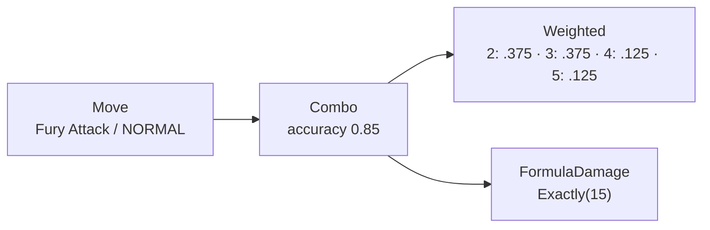

# Context

This repository is a terminal Pokémon battle built to answer one question: what does a
battle system look like when every source of variation is an object instead of a branch?

It follows Christopher Okhravi's two videos:

1. [Rebuilding Pokémon with Object Oriented Programming](https://www.youtube.com/watch?v=CyRtTwKeulE)
   builds the DSL: moves, attempts, effects, conditions, numbers, targets.
2. [Accidentally Used Design Patterns When Rebuilding Pokémon](https://www.youtube.com/watch?v=f_0TFCNvCC4)
   names the patterns that design turned out to use.

The companion book is *The Object Oriented Way*. Transcripts of both videos, with the
whiteboard diagrams reconstructed, are in
[TRANSCRIPT-01-rebuilding-pokemon-with-oop.md](TRANSCRIPT-01-rebuilding-pokemon-with-oop.md)
and
[TRANSCRIPT-02-accidentally-used-design-patterns.md](TRANSCRIPT-02-accidentally-used-design-patterns.md).

The project is an implementation, not a reproduction: the DSL is faithful, while the
roster, type chart, status rules and battle loop are additions needed to make it playable.

## At a glance

| | |
|---|---|
| Language | Java 27 |
| Build | Maven (`pom.xml`), executable JAR |
| Entry point | `com.pokemon.Main` |
| Data | `src/main/resources/pokemon.csv` |
| Dependencies | none |
| Tests | none; the battle loop is the integration test |

## Build and run

```powershell
mvn -q clean package
java -jar target/PokemonOOP-1.0-SNAPSHOT.jar
```

The JAR is Java 27 bytecode (`maven.compiler.release=27`); run it with Java 27 or newer.
If `java` on `PATH` is an older JRE, use the JDK that Maven used:

```powershell
& "$env:JAVA_HOME\bin\java" -jar target/PokemonOOP-1.0-SNAPSHOT.jar
```

`mvn -q compile` is enough to check that a change compiles. The program is interactive:
pick a Pokémon by number, then pick a move by number each turn.

## What the program does

1. `Main` loads the roster from `pokemon.csv` through `PokemonLoader`.
2. The player picks a fighter; the CPU picks a different one at random.
3. `BattleEngine` runs rounds. The faster battler acts first.
4. Before acting, sleep, freeze and paralysis are checked; each can skip the turn.
5. The chosen `IMove` is executed with a `Battle` holding attacker and defender.
6. After the move, burn, poison and badly-poison damage is applied to the attacker.
7. The round repeats until one side faints.

Everything between steps 4 and 6 is the DSL. The engine only decides *when* to call
`execute`; the move decides *what happens*.

## The six interfaces

| Interface | Method | Role |
|---|---|---|
| `IMove` | `execute(Battle)` | A complete move: name, element, mechanics. |
| `IAttempt` | `execute(Battle)` | The hit/miss machinery. Leaf or chain. |
| `IEffect` | `apply(Battle)` | A state change: damage, status, heal, faint. |
| `ICondition<T>` | `check(T)` | A predicate over a battle, a battler, or a number. |
| `INumber` | `evaluate(Battle)` | A `double` that is computed, not stored. |
| `ITarget` | `resolve(Battle)` | Picks a `Battler` (attacker or defender). |

They live in `com.pokemon.api`. Implementations live in `moves`, `attempts`, `effects`,
`conditions`, `numbers` and `targets`; `battle` and `data` hold state and wiring.

| Package | Contents |
|---|---|
| `battle` | `Battle` (turn state), `Battler` (stats, status, moves), `Element` |
| `moves` | `Move` leaf and the two `IMove` decorators |
| `attempts` | `Attempt` leaf, `Cascade`, `Combo` |
| `effects` | damage, status, healing, `Sequence`, `ConditionalEffect`, `NoEffect` |
| `conditions` | logical, probabilistic, numeric, battler predicates, `For` |
| `numbers` | constants, ranges, weighted dice, arithmetic, battle readouts |
| `targets` | `Attacker`, `Defender` |
| `data` | `MoveRegistry`, `PokemonLoader`, `TypeChart` |

## Composition instead of configuration

There is no `switch` on move names anywhere. `MoveRegistry` maps a key to an object graph
built from the same handful of types, and `pokemon.csv` refers to moves by key.

A leaf move is three objects:

```text
Move("Tackle", NORMAL)
└── Attempt(95%, FormulaDamage(Exactly(40)))
```

Fury Attack is the video's showcase: one accuracy roll, a weighted hit count, and one
effect repeated per hit.



| Move | Shape | Idea |
|---|---|---|
| Tackle | `Move → Attempt` | The leaf case. |
| Triple Kick | `Move → Cascade(3 × Attempt)` | Each hit rolls; a miss stops the chain. |
| Body Slam | `Move → Attempt → Sequence(damage, ConditionalEffect(30%, Paralysis))` | Effects compose into a tree. |
| Fury Attack | `Move → Combo(accuracy, Weighted, damage)` | The hit count is an `INumber`, resolved lazily. |
| Thunder Wave | `WithApplicability(WithPrecondition(Move))` | The video's order; the code nests the two the other way (see Fidelity notes). |

## Design-pattern audit

This is the answer to "did I implement the second video correctly?". At the type level,
yes. Each pattern is present in the shape the video describes; the one semantic slip is
the decorator order in two moves (see below).

| Pattern | Where it lives | Verdict |
|---|---|---|
| **Strategy** | `INumber` (`FormulaDamage` does not know which number it gets), `IEffect` (`Attempt` does not know which effect), `ICondition` (`Probability` as accuracy, `HasElement` as applicability) | Correct. Families of interchangeable algorithms behind one method. |
| **Composite** | `Sum` / `Product` / `Quotient`, `Sequence` / `ConditionalEffect`, `And` / `Or` / `Not`, `Cascade` / `Combo` | Correct. A composite implements the same interface it contains, so leaves and trees are used uniformly. |
| **Decorator** | `WithPrecondition`, `WithApplicability` | Correct shape: same `IMove` interface, exactly one wrapped component. Order is wrong in two moves. |
| **Command** | `IMove` is the command, `Battle` the receiver, `Battler` holds the commands, `BattleEngine` calls `execute` | Correct, with the video's own nuance: the holder and the caller are split across `Battler` and `BattleEngine`. |
| **Null Object** | `NoEffect` as the default `onMiss` / `after` effect, and as the default `onFail` branch | Correct. Effect slots are never null and callers never special-case "nothing". |

### Strategy and Composite in one sentence each

`FormulaDamage` takes an `INumber power`; whether that is `Exactly(90)`, `MaxHP(target)`,
or `Sum(a, b)` is invisible to it. `Sum` takes two `INumber`s and is itself an `INumber`,
so arithmetic nests without limit. The same two moves appear in effects (`Sequence`,
`ConditionalEffect`) and conditions (`And`, `Or`, `Not`).

### Decorator versus Composite

The distinction the video stresses: a decorator holds **one** component and adds a
responsibility before or after delegating; a composite holds **many** and treats them as
a group. `WithPrecondition` wraps one move. `Cascade` holds a list of attempts. Both
implement the interface they hold.

## Fidelity notes

### Fase 1 remediation contract

The Fase 1 fidelity and output corrections are implemented and were exercised through
the terminal battle in issue #14:

- Decorated move identity is read through the known `IMove` decorator chain, so the menu
  shows the inner `Move` name. `BattleEngine` prints the used line before execution,
  including when a decorator rejects the move.
- Applicability is the outer decorator and precondition is the inner decorator for
  Thunder Wave and Will-O-Wisp. Applicability therefore has failure precedence when
  both checks fail.
- Jump Kick uses the distinct `CrashDamage` effect. On a miss it prints the crash line
  and applies half of the attacker's maximum HP as self-damage.
- Body Slam uses 100% accuracy, 85 power, and a separate 30% conditional paralysis
  effect.
- Combo performs one accuracy check, prints its animation before each applied hit, and
  reports the number of applied hits. `lastAttemptHit` remains the single accuracy-roll
  result.
- `Leq` and `Geq` intentionally remain `ICondition<Battle>` because `INumber` evaluates
  with `Battle`; no broader numeric lifting seam was specified.
- Seeded randomness in `Battle` remains out of scope. Random objects remain composable
  but are not seedable through the battle context.

The proof fixtures make the required paths reachable without changing the level-50 stat
scale or adding a roster row: Machop's `CrossChop` slot is now `JumpKick`, and Gengar's
`SwordsDance` slot is now `ThunderWave`.

The remaining Fase 2 rules and unrelated cleanup are not part of this issue. The terminal
battle remains the integration test; there is no JUnit suite.

### Remaining documented deviation: randomness

The video suggests a seeded randomizer on the battle context (46:10–46:17), so that all
random objects draw from one predictable source. The code calls `Math.random()` directly
in `Weighted.evaluate` (`numbers/Weighted.java:34`) and in `FormulaDamage.apply`
(`effects/FormulaDamage.java:68`). The design is still composable; it is simply not
seedable.

### `LastDamageDealt` is targetless — as the video concludes

`LastDamageDealt` (`numbers/LastDamageDealt.java`) returns `battle.getLastDamageDealt()`
without asking *whose* damage. At 49:43 he says it "probably shouldn't take a target. It
should just be last damage dealt within the battle. You know, you decide." The leaf matches
that reading. No registered move uses it today; it exists for Counter-style moves.

### Additions that are not deviations

`TypeChart`, the full status set, `pokemon.csv`, `PokemonLoader`, `BattleEngine`, the
end-of-turn status damage and the terminal UI are not in the videos. They are the game
around the DSL. Keep them out of the DSL's type map: a new *rule* may belong in the
engine or the type chart, while a new *move mechanic* belongs in an `IMove` composition.

## Adding a move

1. Compose it in the static block of `MoveRegistry` from existing parts.
2. Give it a key; that key is what `pokemon.csv` stores.
3. Reach for a new class only when the behaviour genuinely does not exist. A new
   `IEffect`, `ICondition` or `INumber` belongs in its package and gets one method.
4. Avoid null: use `NoEffect` for an empty slot and the one-argument `ConditionalEffect`
   constructor for an empty else-branch.
5. Decorated moves: the menu name and wrapper order are covered by the Fase 1 remediation
   contract above.

## Adding a Pokémon

Add one line to `src/main/resources/pokemon.csv`. The file has no header and 14 columns:

```text
name, element1, element2-or-"-", maxHp, level, attack, defense,
spAttack, spDefense, speed, move1, move2, move3, move4
```

Element names must match the `Element` enum; move keys must exist in `MoveRegistry`.
A malformed line is skipped with a message, so a typo costs one Pokémon, not the run.

## Roadmap: PokéAPI

`src/main/resources/API.txt` points at <https://pokeapi.co/>. The intended next step is to
replace the hand-written roster with a loader that produces the same objects:

- fetch species, stats and moves from PokéAPI;
- map stats and types onto `Battler` and `Element`;
- map each API move onto an `IMove` composition, reusing the registry where possible;
- cache responses and keep the CSV as the offline fallback.

The DSL should not change. If the API needs a new mechanic, add an implementation of an
existing interface; if it only needs new data, add a loader. That boundary is the point
of the design.

## Reading order

1. This file.
2. Video 1 transcript, chapters 00:04–00:36 for the types and 01:00–01:06 for the two
   object graphs.
3. Video 2 transcript, chapters 00:40–36:16 for the pattern names.
4. `MoveRegistry`, with the transcripts open beside it.
