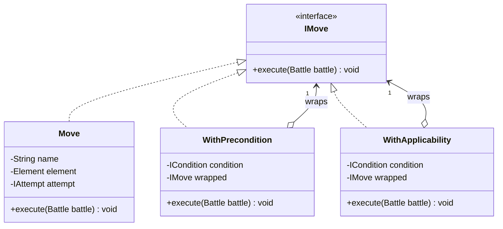
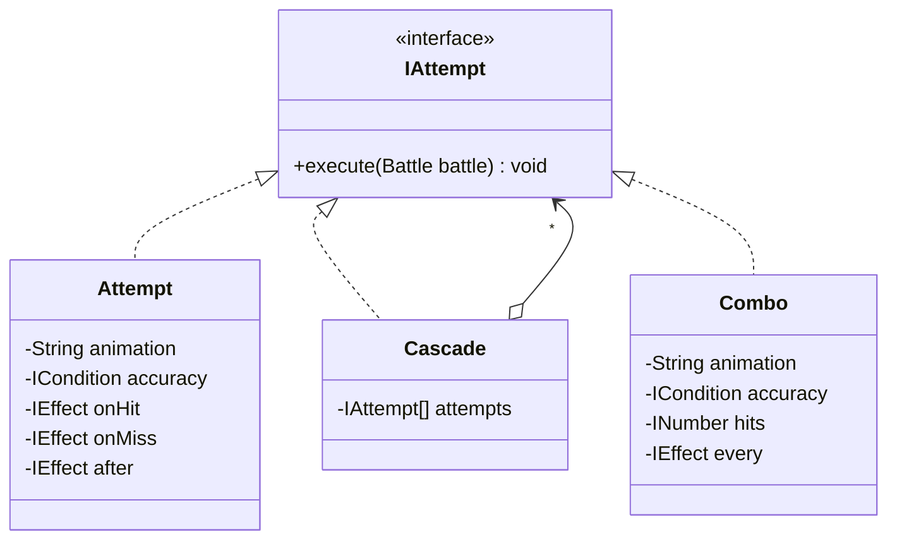
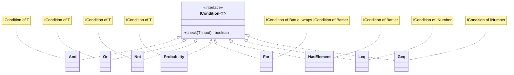
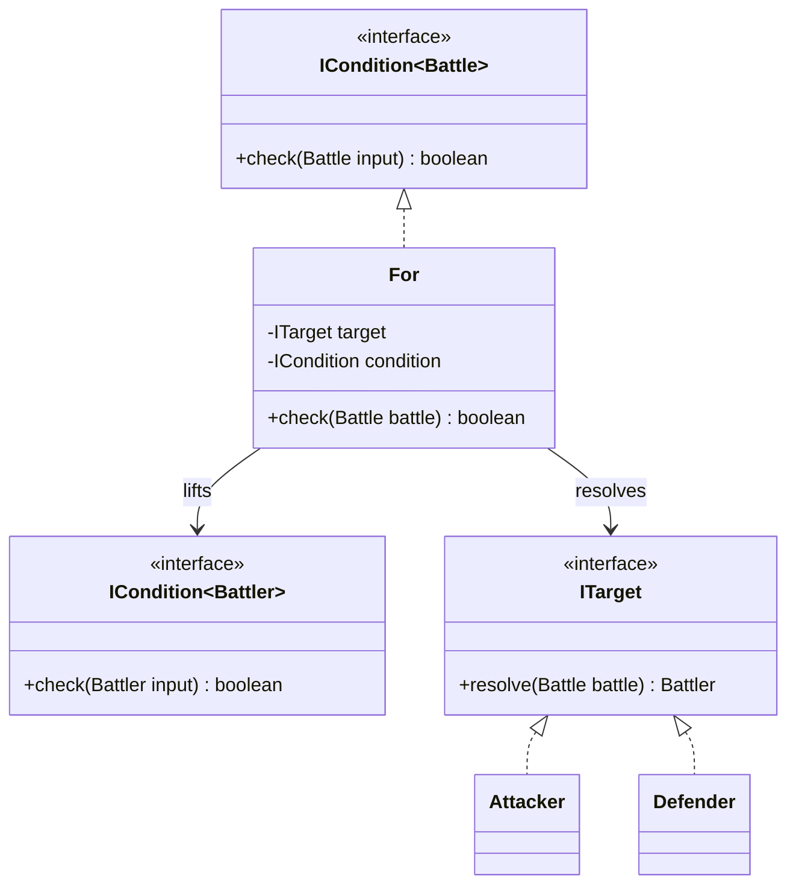
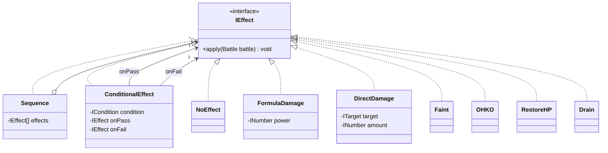
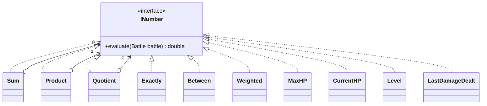
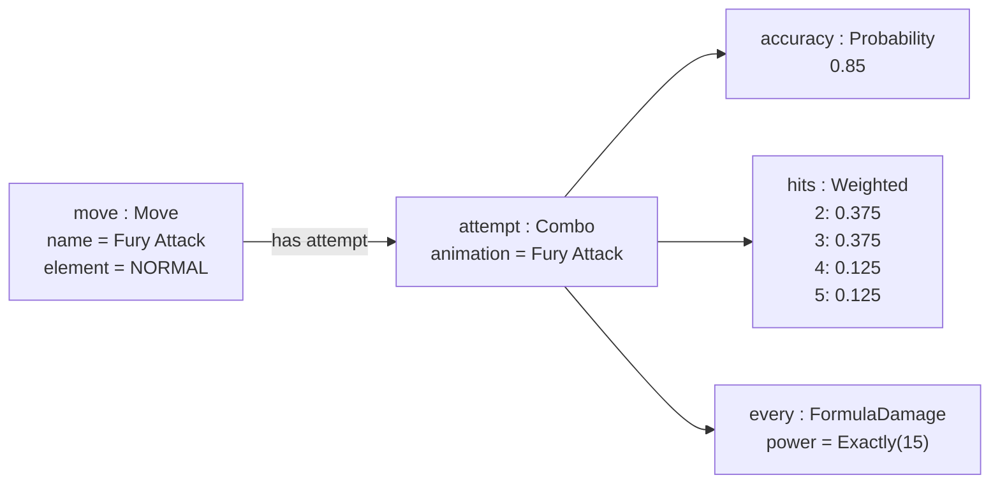
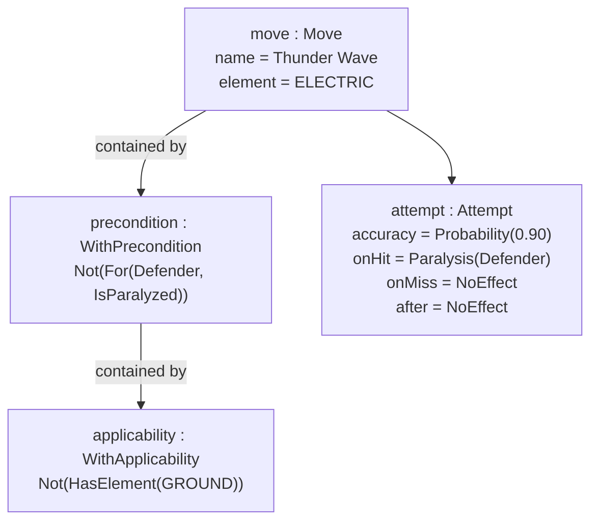

# Rebuilding Pokémon with Object Oriented Programming

> **Evidence record.** Verbatim transcript captured from the YouTube transcript panel
> with Playwright on 2026-11-12. The speaker is Christopher Okhravi; the words are his.
> Captions are auto-generated, so speech-recognition errors remain (obvious encoding
> corruption has been repaired). Diagrams are reconstructions of the whiteboard, drawn
> from the video frames — not screenshots.

| Field | Value |
|---|---|
| Channel | Christopher Okhravi |
| Video | Rebuilding Pokémon with Object Oriented Programming |
| URL | https://www.youtube.com/watch?v=CyRtTwKeulE |
| Duration | 1:06:31 |
| Captions | YouTube auto-generated (English) |
| Captured | 2026-11-12 |
| Method | Playwright (Chromium), YouTube transcript panel |

---

## 00:00:00 — Intro

- **0:00** — Let's build the battle mechanics of the game Pokemon in an object oriented style. I'm pretty excited about this one. Okay, so why should we do this?
- **0:09** — Well, I often get requests to give bigger examples and solve bigger problems, which is totally understandable, right?
- **0:15** — Because when we discuss design principles and design patterns, we often have these tiny examples that focus on one particular small detail, which is all good, right?
- **0:24** — But sometimes we got to look at the bigger picture. So let's do something bigger.
- **0:29** — We're not going to build the whole Pokemon battle system, but, I've got some ideas and I've done some work behind the scenes. So if you like this video, then let me know and we can keep on digging.
- **0:38** — You know?
- **0:38** — So there is a lot of variation between the different generations of the Pokemon games, and we're not going to stay true to any single one generation or game.
- **0:45** — Instead, I've opted to take details from different generations and games to make this video and this discussion more interesting. Here's the gist of the game.
- **0:53** — There's two players battling each other.
- **0:55** — Each player has a bunch of Pokemon, and each player has one active Pokemon at any given time.
- **1:00** — And when a round begins, each player chooses a move for their Pokemon without knowing what the opponent chose, what moves the opponent chose.
- **1:08** — And then we execute the moves one after the other, and that's a round. And then we rinse and repeat.
- **1:13** — But preparing for this video, I've spent way too much time digging into the mechanics and the moves of the games.
- **1:19** — And as you might know, there's so many different things that can happen in a battle in so many different ways.
- **1:24** — So when modeling, we've got to be really careful to make sure that we are capturing effective abstractions, abstractions that help us reduce complexity, not abstractions that introduce additional complexity.
- **1:37** — Oh, and before we get started.
- **1:38** — If you like this video, then you will definitely like my book, The Object Oriented way. There's a link in the description, so definitely check it out. Okay, let's go.
- **1:48** — So we're going to try to go from the outside and in instead of going from the inside and out or top down rather than bottom up. depending on how you would like to think about it.
- **1:56** — Because of that, our types will use other types that we haven't introduced yet, but that we will introduce later.
- **2:01** — And the purpose of doing it this way is of course, so that we can know how a particular thing is used.
- **2:07** — Before we dive into how that thing is actually built and what that thing is composed of. So let's start with some basics.

## 00:02:11 — Battles & Battlers

- **2:13** — Let's assume that we have a class called battle and we have another class called battler. So the battler would of course then be a Pokemon right.
- **2:21** — Someone partaking in a battle.
- **2:22** — And the class called battle should perhaps rather be called turn, because we have an attacker and we have a defender.
- **2:28** — And when one Pokemon is attacking the other, then that particular Pokemon acts as the attacker and the other acts as the defender, but then when that turn is over, you know, we flip it,
- **2:37** — and so the Pokemon that used to be the defender is now the attacker, and the Pokemon that used to be the attacker is now the defender. So it's directional, right? So this type has directionality.
- **2:46** — You could think of it as representing a turn. But that's related to design decisions that we're not making right now. Right.
- **2:51** — That's not part of this discussion because we're going to focus very strictly on move resolution on designing a move in the Pokemon battle system, and then think about how that move could be executed.
- **3:02** — so there are many different ways of implementing this idea of a battle.
- **3:05** — I mean, you could have a battle class and then when you want to switch directions, when you want to end one turn and move to the next turn so that the attacker becomes a defender and the defender becomes the attacker, right.
- **3:13** — You could have a void method here that mutates the battle class, and then just switches the places of the attacker and the defender, right. Swaps them.
- **3:20** — Or you could think about it as that every turn has a new instance of the turn class.
- **3:24** — That's a different discussion and again, let me know if you want to dive deeper into this domain.
- **3:28** — But we have a battle or we have a turn and that turn or that battle consists of a number of battlers, has a, right, and it's not a it's actually two because it's an attacker and it's a defender.
- **3:38** — Then of course, dot dot dot here and dot dot dot here, there's probably a bunch of other stuff here in the battle. And what about the battler right. The battler at least has a name, right?
- **3:46** — It's like Pikachu and it has some elements, right?
- **3:49** — So Pikachu would be electric, and Charmander would be a fire Pokemon, and Bulbasaur would be a grass Pokemon, and so forth and so forth. Right? And then that battler also has some HP, some health.
- **3:58** — And in the game Pokemon, if they run out of health, then that Pokemon faints. Okay. now we've set the stage of the basics, so let's move on.

## 00:04:05 — Moves Supertype

*Whiteboard reconstruction. The board writes the decorators as `WithPrecondition(ICondition<Battle>, IMove)` and `WithApplicability(ICondition<Battler>, IMove)`; `Move` is `Move(name, element, attempt)`.*

- **4:05** — The thing we're going to focus in on is the idea of a move, How to represent a move using objects. Think about it.
- **4:13** — How to resolve a move within the context of a battle. So we have a move. And how is that move resolved within the context of a battle?
- **4:21** — And if you want to think about the battle as a turn right, how is a move executed within the context of a turn?
- **4:26** — And then you can see that directionality matters because it matters who is the attacker and who is the defender.
- **4:31** — By the way I should mention that of course there's a bunch of different ways of representing moves following object oriented principles.
- **4:37** — And there's a bunch of different ways of representing moves in any given programing language. Right. This is just one idea.
- **4:42** — So I'm not by any means trying to claim that this is the one idea and this is how it should be represented.
- **4:47** — And of course, for many historical reasons such as hardware constraints the moves in the actual games of Pokemon back in the days, were of course, not represented like this, right?
- **4:54** — But now we're just trying to take this case and we're trying to say, okay, but if we're trying to follow modern object oriented principles, how would we represent the notion of a move for a game like Pokemon?
- **5:04** — I'm not trying to say this is the way they did it, and I'm not trying to say this is the only way, but I am saying I think this is a good way. So so let's dive into it.
- **5:11** — So up in the top here we have an interface called IMove. This represents the idea of a move, the general idea of a move. What is a move?
- **5:18** — A move is something that can be executed. Remember what we said a move can be executed, resolved. This could have been called resolve.
- **5:24** — Resolved, executed within the context of a battle. What does that mean?
- **5:28** — That means we have to take a battle as input a move can be executed within a battle. What does it return? It returns void. Returns nothing. Right?
- **5:36** — Because here I'm thinking of this as that moves mutate the state of a battle.
- **5:42** — They take a battle in as input, and they mutate that battle so that when the move has been executed, the move has been executed within the context of that battle. Now, of course.
- **5:52** — If you like immutability, you could have said that execute maps from battle to battle. So instead of returning void, you would return a battle.
- **6:00** — So instead of mutating the battle that you take in, you would construct a new battle object from the battle that you were given and then return that.
- **6:08** — And so then you would have immutability.
- **6:10** — Or if you think about it as a turn you would take a turn as input and you would produce a turn as output. Right? That would be perfectly fine.
- **6:16** — But in order to keep things simple Let's not go the immutability route, but let's embrace mutation and say that the one thing that we're mutating is the battle, right?
- **6:23** — As you're going to see the moves, however, they are immutable. We don't mutate the moves. Okay, so there's the super type move.
- **6:30** — There's the interface move that just specifies that in order to be a move, you must have an execute method. Okay. So what does that mean?
- **6:36** — Does that mean that we then create a tremendous number of subtypes for each type of move that there is, there's like thundershock and, fury attack and Triple Kick and like do we have one subtype for each move?
- **6:48** — I mean we could do that, right. but that's not what we're trying to do here. We're trying to follow object oriented principles.
- **6:52** — We're trying to avoid duplication, and we're trying to lock in a language that makes it possible to express legal moves.
- **7:01** — Legal moves that exist now, but also legal moves that could exist in the future. If we would want to come up with new moves for the game.
- **7:08** — What do I mean when I say legal moves? I mean, there are some constraints, right? There are some invariants. There are some things that all moves have to adhere to.
- **7:15** — There are some rules about how a move behaves. And this ties back to the idea of making impossible states impossible.
- **7:21** — You should definitely check out my other videos if that sounds interesting to you.
- **7:25** — Okay, but we have this super type move and then the main player here is the subtype that's also called move Okay. So what does a move contain?

## 00:07:26 — Concrete Moves

- **7:32** — It has a name. It has an element And it has an attempt. What are the types of these? The name is a string, like a move for Pikachu would be thundershock.
- **7:39** — And then the element of that move again, these are types in Pokémon, so the element might be electric. And then the attempt. Here's something we haven't talked about yet right.
- **7:47** — Here's something that's not part of this picture. The attempt is an object of type IAttempt of this interface. Right. And we're going to get to that in a minute.
- **7:54** — This is what I mean when I say that we're going top down. Right. So bear with me. A move consists of an attempt, an attempt to do something. And we're going to look at what that attempt is.
- **8:02** — But for now a move has a name, has an element and has an attempt. Okay. Why do we have these other two subtypes and what's up with the arrows? Right.

## 00:08:05 — Preconditions & Applicability

- **8:09** — We have one subtype called with precondition and another subtype called with applicability.
- **8:14** — And both of these have an ICondition but one is an ICondition for a battle and the other is an ICondition for a battler.
- **8:21** — So notice the generics right, parametric polymorphism. ICondition is a generic type. So it's ICondition of t. And of course we will look at what these IConditions are.
- **8:30** — And we'll look at what kind of different conditions we can express. But we'll do that later.
- **8:33** — For now just think of it like this a condition takes something as input and produces a boolean as output. It's a predicate. Right. But we're not saying it's a pure predicate.
- **8:42** — It could be something related to randomness or probability.
- **8:44** — It's something that takes something as input and then produces a boolean true or false as output.
- **8:49** — And so on this left hand side the type argument that replaces the type parameter is battle.
- **8:53** — And so that means that this condition will take something of type battle in will take a battle in and produce true or false as output and this condition on the right hand side here the type parameter is battler.
- **9:04** — So it will take a Pokemon and it will take a battler in and it will produce true or false out. Okay. What is the second attribute that we have in these two types? The second attribute is of type IMove right.
- **9:13** — You will notice that sometimes I'm specifying the names of attributes. Sometimes I'm specifying only the type. And sometimes I'm specifying both. Right.
- **9:19** — We're trying to sort of be pretty compact and have the discussion that sort of a higher level okay. And here I'm specifying only the types. Okay, so what does this move?
- **9:27** — Well, let's take a step back and say it like this.
- **9:30** — Why do we have something called with precondition and why do we have something called with applicability.
- **9:34** — So the way moves in the game Pokemon work is that some moves might not always be legal to execute.
- **9:40** — So you can try to execute the move and you will lose your turn on the basis of trying to execute that move.
- **9:46** — But the move might not actually do anything, and it's not because the move misses, right. It's not like you're using a move like slash. You're trying to slash. You're trying to hit the opponent.
- **9:54** — But your slash, your punch or whatever it is misses. It's not a miss, right.
- **9:59** — But it's just the fact that you tried to use the move but as you were trying to use the move, you discovered that actually, this move can't be used now.
- **10:05** — It could be something that, like the Pokémon that you're targeting is not susceptible to that because of, let's say, a wrong element, right?
- **10:11** — Your move is of one element, and it can't be used on the other opponent, which is of some other element. and the reason for this might be arbitrary. Right.
- **10:18** — So you have applicability and preconditions. Why have I separated these two? Okay. Because this sort of happens in two passes.
- **10:25** — You can either fail on the battle level or you can fail on the battler level. And in the game Pokémon, this gives different messages.
- **10:32** — so a failed precondition will, in the game give the user a message, that says. But it failed. Right. So it would be something like Pikachu used Thunderbolt.
- **10:41** — Next screen. But it failed. Right. Because for some reason we didn't satisfy the preconditions. We weren't allowed to actually even try to execute that move.
- **10:49** — What might an example be of preconditions?
- **10:51** — It might be that you're checking both the attacker and the defender, and then you're checking that the attacker has a level that is higher than the level of the defender.
- **10:58** — And so that requires access to the battle, because we're not just checking the target Pokemon, but we're checking both Pokemon. But it could also be something related to weather or, you know, whatever.
- **11:07** — Something that requires that we have access to the battle, to the given turn. But on the other hand, what is applicability?
- **11:13** — If the applicability condition fails in the actual game, then we get a message along the lines of but it didn't affect the target. Right.
- **11:20** — So that could be something like, you know, we're trying to execute a move but the Pokemon that we're trying to execute it upon has a type that is not susceptible to this attack to this move and so we get that message, but it did not affect yada yada yada yada.
- **11:33** — Whoever it didn't affect okay. So these are different reasons. They're different reasons for failure.
- **11:38** — And some moves have both types of failure modes and some moves only have preconditions and some moves only have applicability.
- **11:44** — So I like this separation because it gives us a natural place to put both of these messages.
- **11:49** — But it also gives a very clear signal to us who are developing moves, what kind of failure we are expressing when we're expressing a move. Okay, so these are the moves right.
- **11:57** — So we have IMove and the move is an IMove and applicability is an IMove and precondition is an IMove.
- **12:04** — But notice these green arrows with applicability has an IMove and with precondition has an IMove. Why? Right.
- **12:12** — Because these are wrappers. These are decorators right.
- **12:15** — Decorators with applicability decorates a move and wraps that move with some applicability condition.
- **12:23** — Similarly with precondition right wraps a move with some condition so that we have that move but with some precondition.
- **12:31** — Right. And so then you can use both or you could use none or you could use one. You could have just a concrete move with no preconditions or applicability.
- **12:39** — Or you could have a concrete move and you wrap it in some applicability conditions.
- **12:42** — Or you have a concrete move and you wrap it in some applicability conditions and some preconditions, and then you can pass that around. Right. So this is very flexible.
- **12:50** — And this is in line with the idea of decorators okay. Let's move on away from moves.
- **12:53** — So here we have learned that we need to understand conditions and we need to understand attempts. And the next thing we're going to look at is attempts.

## 00:13:02 — Attempts Supertype

- **13:02** — In the top here we have the super type the interface IAttempt. And attempts happen to have the same signature as we had with moves.
- **13:09** — So there's a method called execute that takes a battle and returns void. Right. And again this discussion of mutation.
- **13:15** — Should you want to go the immutable route, you would probably say that you have a method called execute that takes a battle and returns a battle because it's not mutating the battle when it's executing, but it's using the old battle to produce a new battle and return that.
- **13:28** — Okay, so what are the subtypes that we have of attempt? We have one called attempt. We have one called cascade and we have one called combo.

## 00:13:35 — Attempts

*Whiteboard reconstruction. `Attempt` is the leaf; `Cascade` and `Combo` are attempts that hold attempts. `Combo` takes one accuracy roll, an `INumber` hit count and one effect to repeat.*

- **13:35** — Let's first look at attempt Notice how the attempt is an IAttempt but there are no outgoing arrows from it on this picture. Right. So an attempt doesn't have an attempt, right?
- **13:43** — It's just an attempt. It's a leaf.
- **13:45** — So an attempt has an animation I'm not specifying a type here because let's not open that box. Let's not discuss animations.
- **13:51** — But I'm stating this to emphasize at what level of the abstraction we ought to find the animation, right?
- **13:57** — Because every time you're attempting something, we should animate something to the user so that the user knows what's happening. Right.
- **14:04** — So that the user can see that, okay, now there's a thing that's happened.
- **14:08** — And so the reason the animation lives on the attempt and not on the move that we just looked at, right. Is because actually a move can consist of multiple attempts.
- **14:16** — We haven't seen that yet, but that's going to be explained through this idea of cascade.
- **14:21** — And so if your move consists of multiple attempts, then you could hypothetically have a move that has different animations for each attempt. So there's a move called Triple Kick, for example, that can do up to three kicks.
- **14:30** — And hypothetically you could have different animations for each of these different kicks. So the animation needs to fall down here to the attempt level.
- **14:38** — And we can't specify it up on the move level to give us that flexibility okay. So we have an animation. Then you have what you have an accuracy. And what is the accuracy.
- **14:45** — The accuracy is of type ICondition for a battle.
- **14:49** — So we're then saying that our random number generator, if we would want to use, you know, the same random number generator over and over, that would live on the battle type.
- **14:57** — So, the accuracy of an attempt is expressed as a condition.
- **15:02** — And of course, as we will see, our condition type could express a lot more things than just chance than just probability. But commonly we would of course say that the accuracy is a probability.
- **15:11** — Right. So this particular attack has this probability of success. This probability of hitting versus missing okay.
- **15:16** — if this condition is true if the attack actually hits the opponent as opposed to misses the opponent, then we would execute this effect.
- **15:23** — an IEffect that we've stored here under the attribute called onHit. We have another attribute called onMiss and we have another one called after.
- **15:30** — So we have three effects tied into one attempt. Because if the attempt hits then we will run the hit effect. If it misses, then we will run the miss effect.
- **15:38** — And irrespective of whether it hits or misses, we will run the after effect.
- **15:42** — And this might seem like a lot of work, but it's actually quite necessary because there's just so many different moves, and some of the moves use all of these, and some of them just use one.
- **15:52** — And of course, when we're looking at these types, you have to keep in mind that when you design the constructor for these types, you can, of course have optional parameters.
- **16:00** — So it would be awkward if for very basic moves we had to specify on miss and after effects, if we don't actually want any on miss or after effects.
- **16:07** — And for many, many moves we don't, right. But then you could have multiple constructors.
- **16:11** — You could have constructor overloading where onMiss defaults to no effect, and after defaults to no effect. You could even do it like this. You could even say accuracy is optional, right?
- **16:20** — You could say the default accuracy is one, right? It's the probability of one. It always hits.
- **16:25** — So then, in order to instantiate an attempt, you would only have to supply an animation and you would have to supply an effect for what happens after that animation.
- **16:32** — But then with constructor overloading, you could be able to express all of them.
- **16:36** — And of course here I'm not suggesting that onMiss should be null when we don't want to express an onMiss effect.
- **16:41** — And I'm not suggesting that after should be null when we don't want an after effect. What I'm suggesting is that we should follow the null object pattern. We will look at that later. Okay.
- **16:48** — So this is the attempt type. So this is how we structure an attempt, an attempted strike okay. What are these two other types?

## 00:16:56 — Cascade

- **16:56** — Let's first do the cascade type. So the cascade type is essentially a sequence. It's a sequence of attempts.
- **17:01** — We're saying, actually, if you want to have an attempt where you can call, execute and pass in a battle and get back void because you're mutating that battle, then you could have a cascade of attempts.
- **17:10** — You could have an object that contains multiple other attempts, multiple IAttempts, and then you're just executing them in order one by one by one by one.
- **17:20** — Right. As a sequence. First the first one, then the second one, then the third one, and so forth. Okay. And so if you would say that you have a cascade, right.
- **17:26** — Notice this green arrow because you're saying the cascade not only is an IAttempt but has a IAttempt.
- **17:32** — We have an attribute here called attempts that I've here modeled as a list of items. It doesn't matter how you actually implement that, right. But we have something called attempts and some collection of IAttempts.
- **17:40** — And each of these attempts within the cascade could either be cascade attempts, combo attempts, or regular attempts. Because all these, all these three are IAttempts.
- **17:49** — and we're saying that the cascade consists of IAttempts. So this is how we're creating this very flexible language for ourselves.
- **17:55** — But it's very well defined in the sense that no matter how we sort of compose these pieces together, no matter how we construct objects, all the objects that we can compose, that we can get the compiler
- **18:04** — to actually compile, that would be valid code, all of those compositions, are reasonable Pokémon moves. Right? So that's when we have to think about when we're designing multiple types.
- **18:13** — So we're trying to solve this big problem.
- **18:14** — We have to make sure that we are creating abstractions that don't shoot ourselves in the foot, we have to create abstractions that don't make it possible to express nonsense.
- **18:21** — And so a cascade contains a bunch of attempts, and then you might have a bunch of regular leaf attempts.
- **18:27** — And so one example of such a move is the move known as Triple Kick, where you're executing a kick once and then if that hits,
- **18:34** — you're allowed to execute the next, and then you execute the kick again, and then if that hits, you're allowed to execute again, and then you executing a kick again, and then that's done right because it's Triple Kick.
- **18:42** — So it's up to three.
- **18:43** — And each of these kicks have their own accuracy because they can miss independently. And each of these kicks have their own animation because they are animated.
- **18:52** — We see one animation, and then we can see that it hits. The defenders HP level drops.
- **18:56** — And then we run the animation of the next one and we can see if that hits and so forth and so forth. So there are independent die rolls for each of these attempts.
- **19:04** — And importantly specifically for the move Triple Kick the effect, the onHit effect is actually different between the three different hits.
- **19:11** — The first kick makes 10 damage, the second makes 20 damage, and the third makes 30 damage. But so the effect can be different between these different attempts.
- **19:20** — And that's why we have this difference between the idea of the cascade and the combo. Right?
- **19:25** — Because the cascade is saying that you now have a cascade of multiple independent attempts. But the combo, on the other hand, the combo is one die roll.
- **19:34** — The combo has one accuracy. There's one animation, and that animation is repeated a number of times. There's one effect, and that effect is repeated a number of times.
- **19:42** — But the die roll, the condition, there's only one condition. You only have one die roll. Either it hits or it doesn't.
- **19:49** — And then you get X number of effects. Okay, but now we moved into combo. Let's step back to Cascade.
- **19:54** — Let me just say for the cascade why is it called Cascade and why is it not called sequence.
- **19:57** — Because in the game Pokemon, as far as I can tell from diving deeply into this, there is no sequence
- **20:03** — that allows you to execute an attempt and then independently execute the next attempt, even if the previous attempt missed.
- **20:11** — So the logic here in Cascade is that if an attempt misses, then The cascade is completed.
- **20:17** — The cascade only keeps going through this list of attempts, as long as your attempts keep hitting. But as soon as they fail to hit right, you're exiting the cascade.
- **20:27** — Okay, so that's why it's called Cascade and not sequence. We will use the word sequence later. Okay. Let's now look at the combo. So I've explained it briefly right.

## 00:20:32 — Combo

- **20:34** — But the combo has one animation that's repeated for every hit of the combo, and it has an accuracy that's only checked once.
- **20:40** — So you check the accuracy and you say: Did it hit or did it not hit?
- **20:43** — And if it hit, then you have to figure out how many number of times it hit so that you know how many times you should play the animation, and how many times you should apply the effect. Right?
- **20:53** — So you have an animation, you have an accuracy, and then you have a number of hits, and the hits is it's a number. Of course we could say that it's a number. but we're going to be smarter than that.
- **21:01** — We're going to say hits is an INumber, and we haven't talked about INumber yet, But the point is INumber is a number that's resolved after you pass it a battle context.
- **21:12** — After you pass it a battle, you will get back a number, right? Because that means that we can have very flexible numbers.
- **21:17** — We can have random numbers, but we could also have numbers that depend on something else, such as, let's say, the level of a battler or the amount of damage that was dealt in the previous attack, and so forth and so forth. Right?
- **21:28** — Think of the hits in the combo as a number, but a number that we can't necessarily specify at the time of instantiating this combo.
- **21:35** — But we can specify how to compute that number when given a battle. We'll get to that in more detail. Okay. And then finally we have this attribute called every which is of type IEffect.
- **21:45** — And every is then the effect that's supposed to be executed as many times as we've hit.
- **21:50** — If the number happens to be a random number between 1 and 3 and you roll the number three, that means that the combo has hit three times,
- **21:57** — which means that we will play the animation three times, and after each animation, we will run this every effect every time.
- **22:03** — Okay, so hopefully you can see how combos and cascades are different kinds of attempts.
- **22:08** — They're still attempts, but there are different structures for the idea of attempt. Right?
- **22:11** — And I think the canonical sort of distinction between these, if you happen to be familiar with Pokemon, is that Cascade models, things like Triple Kick and combo models, things like Fury Attack.
- **22:21** — And you can see the difference between these also in the messaging if you play the old Pokemon games, because when you run combos, after the attack has executed, you get a message that says, it hit X number of times, right?
- **22:32** — If it hit three times, it will say "hit 3 times". But cascades, they won't do that, right.
- **22:36** — Triple Kick won't do that you get up to three hits, but it doesn't say oh, it hit only two times. Okay, let's keep on digging. Let's now, talk about conditions.
- **22:43** — Before we talk about effects, I know that we have to talk about the effects. Right.
- **22:46** — But before we talk about effects, the things that can happen, let's first talk about the conditions for when these effects are allowed to happen.

## 00:22:55 — Conditions

*Whiteboard reconstruction. `ICondition<T>` is the whole condition family: logical combinators, probability, comparison of numbers, and the battler predicates lifted by `For`.*

- **22:55** — So we have this generic type called ICondition. Notice the type parameter here T. We have ICondition of T. And what is the method? What is the key player here for ICondition?
- **23:04** — We have a method called check that takes something of type T and produces a boolean. That's what we said before right?
- **23:10** — if you have a battle condition then it will take a battle and it will produce true or false as output.
- **23:14** — if you have a battler condition, then when you run check you have to pass it a battler and then you will get a bool true or false back. Okay.

## 00:23:22 — Logical Conditions

- **23:22** — There's a bunch of stuff here, but let's first start with what we might call combinators. So here we have these combinators We have and or and not.
- **23:30** — And forgot to put the type parameter here.
- **23:32** — But this should of course be a generic and a generic or in a generic not so it should say And and Or and Not. Okay.
- **23:40** — So notice how not or and and how these are all IConditions of T they are IConditions of T.
- **23:46** — But notice how they also have IConditions.
- **23:50** — The reason we're doing this is that if we're expressing conditions, if we're expressing predicates, we need to be able to combine different predicates to make more complex predicates, to make more complex conditions.
- **24:01** — And how do we chain them? We can chain them using logical operators. Right. So what would be the implementation of And for example? It would be like an And condition.
- **24:09** — For the type argument, T would have to contain two other conditions also for T so that when you're calling check on the And condition,
- **24:16** — you would have to call check on both of these sub conditions and only if both of them report True, does the And return true. And similarly for Or right.
- **24:24** — the Or would also have to contain two conditions but if one of those two sub conditions happened to be true, then the Or will return true.
- **24:32** — And Not of course, is inverting, right?
- **24:34** — Not with only contain one condition and if that condition is true, then the Not condition is false.
- **24:39** — And if the inner condition is false, then the outer condition, the outer Not is true, right?
- **24:44** — This gives us a way of combining conditions to make more complex conditions.

## 00:24:48 — Probabilistic Conditions

- **24:48** — And here as a final subtype of ICondition of T, we have this type called probability. I just wrote prob in order to save space. Right.
- **24:55** — But what I mean is probability.
- **24:56** — This can of course be generic because what we're trying to express here is just a probability, right. in the constructor you might pass a double like 0.5.
- **25:03** — That means 50% of the time this probability will return true and 50% of the time this will return false.
- **25:09** — And of course, depending on your liking, you might want to choose different names instead of And you might want to call this Both and instead of Or you might want to call this Either and instead of Probability you maybe want to call this Chance.
- **25:19** — But either way, something like this gives us a lot more expressivity when it comes to expressing different conditions for different moves.
- **25:25** — And of course, I should say that some of the things we're doing here, wouldn't make sense if you would want to use delegates. Right?
- **25:32** — Because then we wouldn't need as much stuff as we're building here.
- **25:35** — But I'm trying to do this exercise using very basic constructs, using sort of strictly object oriented programing to emphasize that it is entirely possible to do this even without stuff like delegates.
- **25:46** — Right?
- **25:46** — It is possible to get a very high level of flexibility in an object oriented language. Even if you don't have delegates, right? You don't have to move to functional programing.
- **25:54** — Okay. Let's keep going. There are 1, 2, 3 more. ICondition super types that we have to talk about. The top one here is an ICondition for INumbers.

## 00:25:59 — Number Conditions

- **26:03** — And again we haven't talked about INumbers. We'll get to that in a moment. But just remember what we talked about before. An INumber will resolve to a double a number if we give it a battle.
- **26:13** — So it's something that we don't know upfront but it's something that can be calculated.
- **26:16** — And so if we have conditions that can be expressed over numbers, if we have conditions that take INumbers as input and produces booleans as output,
- **26:24** — then of course we can have one called less than or equal to and another called greater than or equal to. Less than or equal to is a condition of numbers.
- **26:32** — Right?
- **26:32** — But it can also contain a number so that we have something to compare it to So when you pass it a number, it will check whether that number is less than or equal to the number that it contains.
- **26:42** — And similarly for greater than or equal to.
- **26:44** — And of course you can have less than, you could have, greater than, you could have equal to, and so forth and so forth.
- **26:48** — And again, again, if you want to go the route of delegates, if you want to pass around functions, then you don't need this much complexity in terms of types.
- **26:56** — You could solve that on the fly with functions.
- **26:58** — But if we're going the object oriented route, then we need this kind of plumbing in order to solve some basic problems. Okay, so those are number conditions.
- **27:05** — Then we have battle conditions here and we have a battler conditions here.

## 00:27:06 — Battler Conditions

- **27:10** — So battle conditions They would to take a battle and then resolve to either true or false.
- **27:15** — And battler conditions would take a battler, someone partaking in a battle, and then resolve to either true or false. Let's first take this idea of IConditions of battlers.
- **27:24** — We have two examples, but we could have any number of conditions. There's so many conditions that we could express. But we have two very clear examples here.
- **27:32** — We have one called has element and we have one called is paralyzed.
- **27:35** — So the question we're asking here is, whether the battler that we have been passed contains that element or not.
- **27:42** — So the way I understand it, a Pokemon can have multiple different elements, can have multiple different types.
- **27:47** — In the constructor of has element we might pass something like electric or fire or grass and then when we're being passed a battler we would check whether that battler has that element or not. Right.
- **27:56** — And so correspondingly we return either true or false. And for is paralyzed. Right. This is a completely different question.
- **28:02** — This is a question of whether this particular battler at this moment has the major status condition, right. In Pokemon battles this is known as a major status condition.
- **28:11** — You can be, paralyzed or poisoned and so forth. Right? So there's a bunch of different major statuses that a battler can have.
- **28:17** — And so the question we're asking here is, if that battler at the moment is paralyzed.
- **28:22** — And so these are questions that we might want to have an answer to when resolving a move. Because some moves depend on knowing this information.
- **28:30** — Right. And we will see how to express that later. Okay. Well what's up with this arrow here. Right.

## 00:28:32 — Battle Conditions

- **28:34** — We don't have any other examples of IConditions for battles except this thing called for. And what is this thing called for?
- **28:42** — Well, this is the idea known as lifting. Right? If you've ever studied category theory, this is the idea of lifting. Also very common in functional programing.
- **28:49** — So what this for class does is that it can lift a battler condition up to the level of a battle condition.

## 00:28:56 — Targets

- **28:56** — We haven't talked about ITarget so let's pause for a moment and look at ITarget. So I target is unrelated to conditions right. It's a thing that we will use for affects as well as we will see later.
- **29:05** — But we have to understand it now in order to understand this for type.
- **29:08** — The super type ITarget says that in order to be an ITarget, you have to have one method called resolve. And the resolve method takes a battle and what it returns is a battler.
- **29:17** — It's just a selector. It's just a way of selecting one of the two battlers from a given battle. So when we're being passed a battle in, we produce one of the battlers as output.
- **29:27** — So if you have the target attacker and you pass it the battle, you will get back a reference to the battler that acts as the attacker in that particular battle.
- **29:36** — And if you have an object of type defender and you pass it the battle, then you will get back the battler that currently acts as the defender. They're selectors. Pretty useful stuff. Okay.

## 00:29:45 — For-Combinator

*Whiteboard reconstruction. `For` is the adapter that turns a battler condition into a battle condition: it resolves an `ITarget` against the battle, then checks the battler.*

- **29:45** — So how do we use this notion of targets within for?
- **29:48** — If you have an instance of the for type of the for class, then that must contain an ITarget. So you would say for attacker for example or for defender.
- **29:57** — And then that for type not only contains a target but also contains a battler condition.
- **30:02** — So what that means is that we can use this lifter to lift a condition on battlers up to the level of conditions for the battle.
- **30:09** — The reason we're doing this right, is so that we don't have to specify battler conditions for both parties. We want to specify the idea of is paralyzed once.
- **30:19** — We don't want to have a type called is defender paralyzed and another called is attacker paralyzed.
- **30:24** — We don't want to have a type called defender has element and attacker has element.
- **30:28** — So instead we're combining we're composing these battler conditions with the for type in order to construct a battle condition.
- **30:36** — Right. A condition that can just be passed the battle.
- **30:38** — And then when we pass a battle, we use the target with just that selector in order to select either the attacker or the defender and then apply that condition, no matter what the condition is, we apply that condition to that particular target.
- **30:50** — Right. I get that this might be a bit confusing, but think about it.
- **30:53** — And I think that will, this will sort of come out in the wash when we're starting to look at instantiations, right. Just think about it like this.
- **30:59** — The point is that we want to express conditions on the level of battlers.
- **31:03** — We want to express conditions as something that maps from a battler, no matter who the battler is, to a boolean.
- **31:09** — But then when we actually use these conditions, we're going to have to use them on the level of the battle.
- **31:13** — We're going to have to pass in a battle and then from the battle, we're going to have to figure out which particular battler that condition should hold for. And that's why we have this for Combinator.
- **31:22** — So now we've covered everything on this page, right? Okay, let's move on to effects.

## 00:31:26 — Effects

*Whiteboard reconstruction. The board names the if/else composite `Condition`; the Java class is `ConditionalEffect`. `NoEffect` is the do-nothing leaf used wherever an effect slot would otherwise be null.*

- **31:28** — So this, I guess, is the heart of the domain specific language, if you will. Okay. So at the top here we have an interface. We have a super type called IEffect.
- **31:37** — The idea of an effect.
- **31:38** — And in order to be a subtype of IEffect, in order to implement the interface IEffect, you have to supply a method called apply, which takes a battle and returns void returns nothing.
- **31:47** — Right? Because why?
- **31:48** — Because we're applying the effect to the battle by mutating the effect into the battle. So this is the same idea as the method that we called execute before.
- **31:56** — It's just that I think the word apply, applies better to an effect, because we're taking the effect and we're applying it to a context. We're applying it to the battle okay.
- **32:03** — So we have the super type effect. And then we have a bunch of subtypes. Notice these green arrows. And notice the red arrows. We have a bunch of leaves.
- **32:11** — And then we have a bunch of decorators a bunch of combinators. Or, I say a bunch, but we actually have two. We have sequence and we have condition. And these two are combinators.
- **32:19** — They are ways of combining effects into effects that do multiple things.
- **32:24** — But then in the bottom we have effects that are just effects that aren't combining multiple effects, but are things that can happen. Okay. Let's first look at the two combinators.
- **32:33** — The two combinators are sequence and condition. And sequence, I mean, is very simple, right? A sequence is an IEffect, but it also has a bunch of IEffects.

## 00:32:36 — Effect Sequences

- **32:43** — And here I haven't specified the type I've just written effects. Right. Because you could model this as a list or whatever you want. Right. But a sequence contains a number of effects.
- **32:52** — And what does it do? It executes the effects in sequence. But hopefully you remember the idea of Cascade, right? When we talked about attempts.
- **32:59** — So you had the cascade that cascades a bunch of attempts.
- **33:02** — There the idea was that if a particular attempt fails then the next attempt isn't executed because the cascade is canceled.
- **33:09** — The cascade is completed in a sense.
- **33:11** — But here, when we're saying sequence, there's no notion of whether an effect succeeded or not. There's just the idea of applying the effect.
- **33:18** — So no matter what happens in the first effect, we will definitely apply the second effect.
- **33:23** — And no matter what happens in the second effect, we will definitely apply the third effect. And so forth.
- **33:27** — So the type sequence just models the idea of a bunch of effects that we want to execute in sequence. Right?
- **33:33** — The reason for doing something like this is so that whoever is using an effect can say that they have one effect and don't have to worry about having multiple effects, right?
- **33:42** — If we think back to the attempts, remember how we had two types, we had the leaf type attempt, and then we had the combo attempt. And both of those make use of effects.
- **33:51** — If we didn't have this sequence that can sequence effects, then both the attempt class and the combo class would have to store the effects
- **33:59** — in something like a list or an array because they want to express that you might have multiple effects, that this attempt might contain multiple effects.
- **34:06** — But because we're using the type sequence, we don't have to do that because we can just model multiple effects as a single effect that is sequenced. Very convenient.
- **34:14** — Okay. What about the next combinator? What about the one called condition? Well condition is basically just an if. Right? Now we're not saying, you know, this might be a miss.

## 00:34:15 — Conditional Effects

- **34:23** — That's not what we're trying to express here. Because think about the messaging in Pokemon, right?
- **34:26** — In the game Pokemon, if someone uses an attack, you can see the animation, and the attack misses, then you get the message it missed. Here, you won't get the message it missed, right?
- **34:35** — That's not the point here.
- **34:36** — The point here is that we're trying to say that sometimes some things happen, sometimes they don't. That's a very general idea, so let's express that as a condition.
- **34:44** — If the condition passes, then we will run the effect that's stored in the attribute on pass, and if the condition fails, we will run the condition that's stored in the attribute on fail.
- **34:54** — And then... Why have I written effect here? I'm sorry... I'm so confused. Right. Of course, it shouldn't say effect here. It should say condition. Let's fix that.
- **35:02** — It should of course, be an ICondition on a battle. Sorry, I don't know what I was thinking.
- **35:07** — So, an instance of the condition type contains an ICondition that can map from a battle to either true or false to a boolean.
- **35:15** — And if that condition passes, we will run the pass effect. And if it fails, we will run the fail effect. And hence we have this arrow from condition all the way up to effect.
- **35:23** — Right? A condition contains effects.
- **35:26** — And as we talked about before, remember how we can of course use constructor overloading to make instantiation of these types simpler. Right.
- **35:32** — So if you have a condition that has both a pass effect a fail effect, you could of course make the fail effect optional so that you can express a condition whereby if that condition passes,
- **35:41** — you will run the pass effect but then if that doesn't pass, it will just have no effect. Right? So then the default value for on fail would be an instance of no effect, right?
- **35:50** — It would be a subtype of IEffect that's called no effect. Right. You can find it here right. And this is essentially the null object pattern.
- **35:57** — So instead of passing around null we would pass around a no effect that simply has no effect where we're trying to apply it to a battle. Okay. So those are the two combinators sequence and condition, right?
- **36:06** — There are ways of combining different effects to make more complex effects. Okay. Let's now look at a bunch of other effects just very quickly.
- **36:14** — Right. Because this is all specific, right. And depending on how many moves you want to model, you have to invent new effects. Or you might want to invent new effects.

## 00:36:21 — Making Impossible States Impossible

- **36:21** — And here there's a very interesting trade off. Right. I have not here tried to identify, let's call them, fundamental combinators.
- **36:30** — I have not tried to build a domain specific language that uses as few combinators as possible. so that we have a few types as possible.
- **36:38** — Instead I've opted for expressivity.
- **36:40** — I've opted for trying to identify types that make the expressing of moves feel natural, feel, obvious. Right.
- **36:48** — So that we can express moves and read moves and understand what they mean.
- **36:52** — Because if you go the fundamental route, you would probably not have something called, direct damage here and then one hit knockout here.
- **36:59** — Because they're sort of variations on the same concept.
- **37:02** — And you could build those variations by combining by composing more fundamental effects. And so this is a trade off. This is a design decision. Right.
- **37:10** — What you're risking when you're, when you're going this non-fundamental route. Right.
- **37:14** — When you're, when when you're introducing a bunch of types to get types that read nicely and get good separation of concerns.
- **37:20** — then on one hand you're risking getting quite many types, but you're also risking duplication.
- **37:25** — And one way of getting rid of that duplication is, of course, to make sure that the types that do the same thing don't duplicate the same code, but instead use other types.
- **37:33** — So that if you have two types that do very similar things then instead of duplicating a piece of code in both types, you make sure that one type is using another type, right?
- **37:41** — That would be one way of solving that issue.
- **37:42** — But of course, I mean, if you would want to, you could go the fundamental route and have very high level combinators. Right, such that, such as these sequence and condition.
- **37:50** — And then maybe you would have something called damage.
- **37:51** — But the further you go here, the more difficult it becomes to read your instantiations of moves, and the longer your definitions for moves become.
- **37:59** — And essentially what you're doing is you're sort of designing a programing language, and we don't want to be in the business of designing a programing language here, I think. Right.
- **38:08** — We want to be in the business of making it possible to express moves in a useful and an effective manner. We want to be in the business of, you know, ergonomics, right.
- **38:16** — We want it to be pleasant to express moves so that we can express a bunch of different moves and make the game very good. Right?
- **38:22** — Because in a sense, right, what's the reason for for going through all these hoops? What's the reason for designing an abstraction like this?
- **38:28** — In my mind, the idea is because we're making ourselves ready to be able to invent a bunch of different moves that we haven't yet thought about.
- **38:35** — And so then we want something which is pleasant, not something which is, elegantly minimal, let's say. Okay, but let's dive into this.

## 00:38:41 — Domain-Specific Effects

- **38:42** — So I think the key type that we should talk about is the one here called formula damage. The key effect is the one called formula damage.
- **38:49** — So the way the damage is calculated in the game of Pokemon in battles is quite complicated, right?
- **38:55** — Like, there's a formula that checks a number of things, such as the attack level of the attacker and the defense level, the defense stats, of the defender
- **39:03** — and the type of the attacker and the type of the attack and the type of the defender and so forth and so forth. Right. And this is where you get all these messages such as: It was effective.
- **39:12** — It was super effective. It was not very effective.
- **39:15** — And there's something called like same type attack bonus or something like this where if the element of the attacker is the same element as the element of the move, then the attack makes extra damage and so forth and so forth. Right.
- **39:24** — And then there's a bunch of randomness, right?
- **39:26** — You can like you follow the formula and you get all the way to computing a number in terms of how much damage should be dealt and then there's some randomness that tells you
- **39:33** — whether or not you will deal 100% of that damage, or down to 80% of that damage and so forth. Right.
- **39:38** — So there's a complex calculation, but that's a standardized calculation that many, many movies follow. But some movies don't. Right.
- **39:47** — And so the moves that follow that want to use the same calculation, we don't want to duplicate that calculation. So where do we put that calculation. Well we put that in formula damage.
- **39:55** — So you can have a move that consists of a bunch of attempts and every attempts could have some effect and one effect it could have is that it could have formula damage.
- **40:03** — So if you think about a move like Triple Kick that hits the opponent up to three times. Then every one of those kicks would be a formula damage.
- **40:11** — And so every one of those independent hits, deals damage according to the formula and would print messages such as it was super effective if it happened to be super effective.
- **40:20** — Okay. So that's formula damage right. And formula damage has an attribute which is INumber. Why does it contain an INumber? Because we have to say how much damage it makes.
- **40:29** — But we can necessarily say that up front because it might depend on, you know, the level of someone or it could be a random number between two numbers, and so forth.
- **40:37** — It could be, could be anything. Right. So many times it is a specified number. But sometimes it isn't.
- **40:42** — And that's why we want to have this idea, this level of indirection, this additional indirection which is INumber. Okay. Why do we not specify a target here for formula damage?
- **40:50** — Because we're making the invariant assumption, right, we're saying one invariant is that formula damage always moves from the attacker to the defender.
- **40:58** — The attacker is always making formula damage towards the defender. So here we don't specify a target because we're saying that that's the default. Right. And I haven't seen any cases where that isn't the case.
- **41:08** — Right. So I think that's a reasonable assumption to make. Okay. But then you can have something like direct damage. Direct damage completely bypasses the formula damage calculation.
- **41:16** — Totally ignoring this notion of elements and so forth, we're just saying let's just inflict damage to some particular target and how much damage, right, as much damage as is given by this INumber.
- **41:27** — So let's just inflict some amount of damage upon this particular target.
- **41:31** — And then we have to specify a target because it could be the attacker or it could be the defender. Then there are a bunch of other effects. What do we have. We have faint, right. You could ask a target to to faint.
- **41:39** — I mean they don't die in Pokemon, right? They faint. And then you can have something like one hit knockout, right?
- **41:44** — You can have an effect that irrespective of how much, HP the defender has, You just immediately knock them out.
- **41:51** — So if we apply that effect, then the opponent will be knocked out, right?
- **41:54** — This is where we would put the message, you know in the game you get this message that says: it's a one hit knockout. And so you would put that into this type.
- **42:01** — And of course I should say that we haven't talked about abilities right in this discussion. This is a massive discussion. But we haven't opened Pandora's box of abilities. Right.
- **42:08** — Abilities can have a bunch of different effects on effects.
- **42:11** — Another reason why it might be important to separate and not just use fundamental combinators, but separate different kinds of effects, such as one hit knockout and direct damage, into different effects.
- **42:22** — Because abilities might have different effects upon these effects. What I'm trying to say is this.
- **42:27** — One hit knockout could just be expressed as direct damage towards the defender with exactly as much damage as the defender has HP, and then combined with a message that says it's a one hit knockout, right?
- **42:39** — You know, you could do that, you could do that.
- **42:41** — But I've opted to separate them because I'm convinced that that will make the implementation of abilities much easier. Beyond the other reasons that we talked about before. Okay.
- **42:50** — What are some other stuff? We here also have restore HP. This is the idea of healing, right.
- **42:55** — So you would restore the HP of the target some percentage represented by this number.
- **43:00** — Again an INumber because you can make that number random or you can derive it from the battle. Okay, then we have drain, paralysis and attack stat change okay.
- **43:08** — Drain is the idea that when you're attacking the opponent, the amount of damage that's inflicted to the opponent might also be drained out of that opponent and gained by you.
- **43:18** — Right?
- **43:18** — So you're inflicting damage upon the opponent and that amount of damage is gained, is given to you as health points.
- **43:24** — And you would want to know what percentage of the amount of damage dealt should be given back as health. Right? And that would be the second INumber here. Right?
- **43:32** — Okay. Okay. So that's a different subtype, drain.
- **43:35** — Then you have this effect that we talked about before called paralysis where you can apply paralysis to some particular target, right. To yourself or to the opponent.
- **43:42** — And then here's another example attack stat change. We mentioned that you have attack level and you have defense level. And so these are stats for for the different battlers.
- **43:51** — So the stats for the battlers can change. And then you need effects that can alter these stats.
- **43:56** — And so attacks that change would take a target because we need to know who we're changing the attack stat of and then it needs to take an INumber which represents the delta.
- **44:04** — How much should we change that stat by? Okay. And again these are just examples of effects.
- **44:09** — You could you could come up with a bunch of different effects but they won't be too many. Right. Because you can then use all these effects to build up all these complex moves.
- **44:19** — And let's start to look at that in just a moment. Okay. So we are going to look at instantiations.
- **44:26** — We are going to look at how to actually build moves in just a moment. But before we do that we have to talk about this abstraction called INumber.

## 00:44:29 — Numbers

*Whiteboard reconstruction. Everything that resolves to a number is an `INumber`: constants, ranges, weighted dice, arithmetic over other numbers, and readouts from the battle.*

- **44:33** — We have to discuss why we're not just passing around doubles, but why we're instead passing around, objects that implement the interface INumber.
- **44:41** — Why this indirection?
- **44:42** — Well, this indirection exists because there are many cases where we don't know the number up front.
- **44:47** — But when given a battle context, when given a context, we can figure out what the number is. Or the number could be random.
- **44:54** — The point is here we have a way to express how to get to the number but we don't have a way to express what the number actually is right now.
- **45:02** — Because we don't know what the number is right now. But when you supply me with a battle, then I can figure out what the number is. Okay.
- **45:08** — So we have a bunch of different subtypes of INumber up here you can see the combinators and then some very Pokemon specific ones.
- **45:15** — and then some more general ones that don't combine numbers. Okay. let's start with the simplest one, which is called exactly. If you would want to you could have called this number.
- **45:23** — But exactly is a type that takes a double. It stores a double. And whenever you evaluate it, you will simply get that double back.
- **45:30** — Right. You could also maybe call it constant. No matter what battle context you pass it, will always get the same, double back. Okay, that's a simple number okay?

## 00:45:38 — Random Numbers

- **45:38** — But then we have randomness. We have two types. We have one called between and we have one called weighted. Remember all of these are subtypes of INumber.
- **45:45** — So they have a method called evaluate that takes a battle and returns a double. How do they come up with a double? Between has two doubles. One representing min and one representing max.
- **45:54** — Right.
- **45:54** — The minimum number that you could end up with and the maximum number that you could end up with. And then this is randomness. This is a uniform distribution.
- **46:02** — It uniformly gives us a random number between the minimum number and the maximum number.
- **46:06** — So whenever you pass it a battle context, it will give you a random number between those two.
- **46:10** — And should you want to have predictable random numbers, should you want to have a seed, you could put the seed in the battle context, right?
- **46:17** — So you would use the same randomizer for all of your objects that generate random numbers. Okay. But what about weighted, right. Because sometimes we don't want a uniform distribution.
- **46:25** — Sometimes you want to say, you know, with 50% probability I want this number with 25% I want this number and with 25% I want this number.
- **46:33** — It's a weighted distribution. That is what this subtype is for.
- **46:37** — And so you could pass it, you know, a dictionary or list of key value pairs or a list of tuples. You decide how to implement this.
- **46:43** — And then you generate a random number again from a randomizer in battle if you want to and then you respect the weights and give the appropriate number.
- **46:50** — So this is a super useful type and we'll see an example of using this later So then we have two examples of randomness: between and weighted. And we have one example of constants: exactly.

## 00:46:58 — Combining Numbers

- **46:58** — Then let's talk about the combinators before we talk about the Pokemon specific stuff. So here we have three combinators: product, sum and quotient. You can have more of course. Right.
- **47:06** — And this is again back to this idea of, we end up re-implementing a programing language in the programing language because we're using classes and we're not using something like delegates.
- **47:15** — But should you want to use something like delegates should you want to pass around functions, you could get rid of a bunch of these combinators, but they are very, very useful. So sorry I haven't specified it here.
- **47:23** — But product of course contains two numbers and what it returns when you evaluate it is that it evaluates both of the numbers, combines them right, multiplies them with each other in order to return the product of those two numbers.
- **47:34** — And what about sum, right?
- **47:35** — Sum contains two INumbers and then what it does is that it evaluates both of these INumbers and then combines them into one number that it then returns one double.
- **47:43** — Right. And quotient right. Same idea, but you have one number one INumber divided by another INumber. And then you perform the calculation and then return that result.
- **47:52** — So product sum and quarter and all are INumbers but also contain INumber. So they are combinators. They're ways of expressing more complex numbers.
- **48:00** — And so you could do things like let's look at the health of the opponent and let's multiply that with 0.5 in order to take half of the opponent's health.
- **48:08** — So you can express quite complex things, with such combinators, assuming that we have other subtypes that give us sort of Pokemon specific numbers.
- **48:16** — Numbers that are specific to the actual domain that we're trying to model.

## 00:48:20 — Pokémon Numbers

- **48:20** — Okay, so let's finally talk about these examples of numbers that are sort of Pokemon specific. We have max HP, current HP, level, and last damage dealt.
- **48:29** — So all of these actually take targets, right? Notice how all of these have an attribute called ITarget. So they're all target specific.
- **48:36** — They're all numbers that act on a particular target from a battle.
- **48:40** — And I should say that I didn't do that here, but, you know, this whole thing we did with lifting with conditions, right?
- **48:44** — Where we have a generic condition and then you have conditions for battlers and you have conditions for battles, and then you can lift conditions for, battlers up to being conditions for a battle.
- **48:55** — Now I'm realizing you could, of course, have done the same thing with numbers where you could have these, target specific numbers that evaluate not based on a battle, but based on a battler.
- **49:04** — And then you lift those numbers up from, being, battler numbers up to being battle numbers.
- **49:11** — But, you know, exercise for the reader, eh?
- **49:13** — but anyway, so, Max HP what it does is that it checks what the max HP is of the target within the battle that we have been passed.
- **49:21** — And current HP checks what the current HP is of the target within the battle that we have been passed and level checks what the level is, right?
- **49:29** — Because, battlers have levels, right? Pokemons have levels. And so level checks what level the target has in the battle that it's been passed.
- **49:37** — And last damage dealt checks what amount of damage was last dealt to the target within that battle?
- **49:43** — Actually, now that I'm saying it, probably last damage dealt shouldn't take a target. It should just be last damage dealt with in the battle. You know, you decide. Okay.
- **49:50** — And so just like with conditions and just like with effects, there's a bunch of stuff that we could keep expressing that all depends on what moves you're trying to model.
- **50:00** — But it's not going to be infinite.
- **50:02** — It's not going to be an explosion of like hundreds and hundreds of different numbers. It's just going to be a bunch of numbers.
- **50:08** — But then we combine those numbers in very interesting ways in order to make interesting moves. And so this is why we have this notion of an INumber.
- **50:16** — and this is why we're not just passing around doubles, but we're passing around INumbers.
- **50:20** — Because when we're evaluating, when we're resolving a move, we have to pass a battle through the whole resolution chain anyway.
- **50:27** — So we might as well just pass that battle through, and allow ourselves the ability to evaluate a number.
- **50:32** — To get a number that comes from that battle context instead of just being a hardcoded number.
- **50:37** — Okay, so let's leave the numbers and let's now actually look at building some moves. Let's now actually build some moves. So this is all I wanted to talk about in terms of the types right.
- **50:46** — Let's now see what we can do with types like these. With a design like this. Okay.

## 00:50:51 — Code Example 1

- **50:51** — If you feel intimidated by the wall of code that just entered the screen Fear not. We'll go through it slowly but quickly.
- **50:57** — But I will also, after this show you two visualizations that hopefully help hammer in how we're actually structuring these things, how we're actually composing
- **51:04** — all these different objects together, how we're wiring them up in order to build moves. But let's for a moment, let's just look at the code. Right. So here we have four different moves.
- **51:13** — Let's take them one by one. Here's a very simple one. One called tackle. So here we would just say we're instantiating a move right. By calling new move. We're instantiating a move.
- **51:22** — We're passing in the string tackle. We're passing in the normal element. And here you know I've used enums. Enumeration types.
- **51:30** — Not very object oriented right.
- **51:31** — The object oriented purists would probably say that no, this is not sensible, this is procedural and you should of course use subtype polymorphism. You should use types here.
- **51:39** — I thought about this a whole lot.
- **51:41** — And I think in this particular case it will probably be more awkward to use subtype polymorphism.
- **51:46** — But, you know, I haven't actually built enough stuff around this example in order to get a feel for whether this will indeed result in us shooting ourselves in the foot or not.
- **51:54** — Right. But for now, let's just stick with, enums. Okay? So we're instantiating a move. We're passing the string tackle and we're passing in the normal element.
- **52:02** — And then we're saying, you know for this move, what is the attempt? Well, this one only consists of one attempt.
- **52:07** — that has a tackle animation, has a probability of 95%, has a chance of hitting of 95%. Right. And what effect does it have when it hits?
- **52:15** — If it hits, what's the effect? The effect is formula damage of exactly 40. Pretty straightforward right?
- **52:22** — It's a normal attack, consists of one attempt, has a tackle animation, has 95% chance of hitting, and it makes formula damage, right?
- **52:29** — It inflict damage following the normal damage calculation with all that that entails. And how much damage it deals is 40. So pretty straightforward.
- **52:37** — And here, you know, we're assuming that we have constructor overloading in place so here we don't have to express what effect we have if we miss and we don't have to express what effect we have after we have either hit or missed.
- **52:48** — So then, you know, we would use the default values, no effect for those two Okay. So that's tackle. Let's now look at a different move. This one is also pretty simple right.

## 00:52:52 — Code Example 2

- **52:55** — It's called body slam. So we're instantiating a move. We're passing in the string body slam. We're saying it's a normal attack, or normal move.
- **53:02** — And then we're saying this also consists of a single attempt. It's a single attempt. But it's a more complex attempt this time. Right. Why? We have an animation okay, fine.
- **53:10** — But what happens if we hit? Right.
- **53:13** — We don't have anything for onMiss and we don't have anything for after but we do have something for onHit. And what we have onHit is actually now a sequence. It's a sequence of effects.
- **53:21** — So when this attempt succeeds, we will execute this sequence of effects. And what's the sequence of effects?
- **53:27** — Well first we will make formula damage of exactly 85. So we will inflict 85 of damage following the standard formula. Okay.
- **53:35** — But after that there's more effects. After that there's a condition. What is that condition? Well, the condition is that we have a probability of 30%.
- **53:43** — Okay. So 30% of the time we will also have this following effect. And what's that effect? Well it's paralysis on the defender. Right.
- **53:50** — We're instantiating paralysis and we're passing in the defender.
- **53:53** — So what happens is that every time this body slam move hits, you do make formula damage, right? If it hits, you make formula damage.
- **53:59** — But you also in addition to that, you also conditionally paralyze the defender, right. With an 80% chance you paralyze the defender.
- **54:08** — So both of these things can happen, but only if the move actually hits. Simple, right? But very powerful. We've expressed some very powerful combinators.
- **54:17** — We've expressed some very powerful types that allow us very succinctly express quite complex moves. Okay, let's look at the two even more complex moves.

## 00:54:25 — Code Example 3

- **54:25** — Here we have a move called a Triple Kick. So we instantiate the move and we pass the string Triple Kick. And then we say that it's a fighting move. But then as an attempt, what's the attempt?
- **54:34** — It's not just a regular attempt. It's a cascade attempt. It's a cascade of multiple attempts. You might recall that we've talked about Triple Kick before. Right.
- **54:41** — So there's a cascade of attempts. How many attempts? One, two, three, that cascade. So if the first one hits we will get the second one.
- **54:48** — If the second one hits, we'll get the third one. And then it's done. Right.
- **54:51** — But if any of these fail along the chain, along this cascade, then the cascade is canceled. So what does this first attempt say?
- **54:58** — Well, we instantiate the attempt. We pass in a kick animation. We pass in a probability of 90%. So it has a 90% chance of hitting.
- **55:06** — Then we pass in formula damage. The formula damage effect. And we pass in exactly ten. Right.
- **55:12** — So we're saying that the first attempt is a kick, has a kick animation, has a 90% chance of hitting, and if it hits it will do formula damage with ten points.
- **55:20** — What about the second attempt? Exactly the same. Same animation. Same probability. But now we're making formula damage with 20 points instead of 10 points.
- **55:30** — And the third attempt in the third attempt, we're doing exactly the same thing. Same animation, same probability. But we're then doing formula damage of 30 points.
- **55:38** — Right. So we're scaling.
- **55:39** — And of course I tried coming up with a few, alternative definitions for Cascade that would allow us to sort of express not only what the first attempt looks like, but what the transformation looks like from the first attempt to the second.
- **55:51** — Because then you could express these sort of arbitrary cascades that are potentially infinite. Right?
- **55:55** — I didn't really end up with something that I found too satisfying, which is why I went with this arguably duplicated structure. But I don't think that this is problematic duplication in any sense. Right.
- **56:04** — Because we're not duplicating, you know, internals. We're not duplicating deep down in the system. We're just, on a very surface level, duplicating what each attempt looks like.
- **56:13** — Right.
- **56:13** — But hypothetically, you could have a move where these attempts would be entirely different, right?
- **56:18** — One makes formula damage, one doesn't make formula damage, and one has one probability and another has a completely different probability. Right.
- **56:24** — So I think cascade as a type that takes concrete attempts is actually a very, very useful type. Right.
- **56:28** — If you're intrigued by this question, right, and if you decide to work on your own type similar to Cascade, but that can express an attempt and then maybe a transformation from attempt N to attempt N plus one, you know, feel free to drop that in the comments it'd be very interesting to read.
- **56:41** — Anyway. So this is the move Triple Kick. Let's now look at one final move. And then we'll leave the code right. And then we'll look at some diagrams again.

## 00:56:43 — Code Example 4

- **56:48** — So so let's now look at the move called jump kick.
- **56:51** — So the move jump kick is a very interesting move because it can actually fail. So here we're instantiating a move. We're passing in the string jump kick. We're saying that it's a fighting move.
- **56:59** — And then we're passing in an attempt. Notice how we're using named arguments here to make it more clear.
- **57:03** — We are passing in both an effect for onHit and we are passing in an effect for onMiss. Okay. But first let's just say that to the attempt.
- **57:11** — We're passing in a kick animation and we're passing in a probability of 95%. So we're saying this attack has a 95% chance of success.
- **57:18** — And if it hits right let's read the onHit branch. What's the onHit effect? The onHit effect is new formula damage at exactly 100.
- **57:25** — So it makes formula damage with 100 points. Okay. But what happens if it misses? What about that remaining 5%? What if it misses?
- **57:33** — If it misses, then we're going to have an effect, which is an instantiation of crash damage. Now, we didn't look at an effect called crash damage, so I apologize for that.
- **57:42** — You can think about it as something similar to direct damage. Right? It's essentially direct damage. It's non-formula damage.
- **57:48** — But hopefully you can recall how we had a few discussions around how it could be argued that it is useful to not just have one type called direct damage, but have multiple different types for different kinds of direct damage.
- **57:58** — And one other kind of direct damage would be crash damage.
- **58:02** — And that one also has a different message that's displayed to the user, because in the game it says something like, you know, kept going and crashed.
- **58:09** — I don't know which pokemons use that attack, but maybe it's like Machop. So like Machop used jump kick but it missed. Machop kept going and crashed. Right.
- **58:17** — And then you have this effect right. and so that's a logical place to put that message as well. Okay. So the crash damage. Right. We're saying who it's for. We're giving a target.
- **58:25** — The target is the attacker. And why is it the attacker? Right. Because this is about missing.
- **58:30** — So it's about I'm trying to hit the opponent, but as I miss the opponent, I accidentally kept going and I crashed, and I hit myself, right?
- **58:37** — So instead of the target being the defender, the target is now the attacker. Okay. So this crash damage needs to know a target and it needs to know how much.
- **58:44** — How much crash damage do we want to inflict on the attacker? Well, here we're using these combinators. Right?
- **58:50** — Then we're saying it's a new product, we're instantiating product, and we're passing in two numbers. Two INumbers. What are these INumbers? Okay.
- **58:56** — One is the max hp of the attacker and the second one is exactly 0.5. Right. So the number 0.5 and the max HP of the attacker.
- **59:05** — So we're saying how much crash damage are we inflicting well we're inflicting half of the max HP of the attacker that crashed.
- **59:14** — Right. it's fairly easy to express quite complex ideas.
- **59:19** — And if you go back to this discussion about, you know, whether we should use more fundamental combinators or combinators that use some of the domain specific language
- **59:26** — here, you can clearly see how if we would have more fundamental combinators, right, less domain specific language, then the building of moves would be much longer.
- **59:35** — Right.
- **59:35** — Because we would have to do more stuff like this when we're sort of taking the product of two things, instead of just saying something like, well, this is crash damage, Or this is formula damage.
- **59:43** — Anyway, so hopefully you can see now how we can express a bunch of very, very different moves. Can we express all of them?
- **59:51** — Most probably not. Right.
- **59:53** — But I spent way too much time digging into this and I'm telling you, we can express quite a few of them. Check it out for yourself if you want to. Okay. Before we leave.

## 01:00:00 — Visualised Example 1

*Object-graph reconstruction of Fury Attack (01:00:00–01:02:43). The weighted hit count and the repeated damage effect are the point: the object graph replaces a switch on “how many hits”.*

- **1:00:00** — Let's visualize this to really hammer in the point. Let's take two different moves, two moves that we haven't looked at yet.
- **1:00:06** — Especially since we have looked at cascade attempts, but we haven't looked at a combo attempt. So let's now look at the combo attempt. So check this out. We're trying to depict sort of informally an object graph.
- **1:00:15** — You might call this an object diagram. It's not UML.
- **1:00:17** — But informally we're trying to think about okay so if you have an object of type move what would it have, what would it be composed with, if we're trying to implement a move called Fury Attack?
- **1:00:26** — Okay, so we have a move. And that move has a name which is the string fury attack. And that move has an element which is normal, right?
- **1:00:33** — Some type of it is normal. Okay. But that move has an attempt. and that attempt is a combo attempt. Okay. That combo attempt has a tackle animation.
- **1:00:41** — That's fine okay. But then we have three parts. We have what effect are we going to run every time we hit? How many hits are we going to make?
- **1:00:49** — And what's the accuracy? Will we hit or won't we hit? Right. So let's do the accuracy first.
- **1:00:54** — So the combo has a probability, it's the accuracy, a probability, and that probability is 85%. So 85% of the time this combo move will hit.
- **1:01:03** — Okay. And when it hits how many hits do we get? How many hits do we get? It's an INumber, right? It's an INumber that when passed a battle will resolve to a double.
- **1:01:11** — Okay. What double will it resolve to?
- **1:01:14** — Well, let's use a weighted distribution to figure out what number we should resolve to okay. So let's use a weighted. And so here are a bunch of weights.
- **1:01:22** — You know we will resolve to the number two 37.5% of the time. We will resolve to the number three 37.5% of the time.
- **1:01:29** — But we will resolve to the number four 12.5% of the time. And we will resolve to the number five, 12.5% of the time. Sorry about the strange numbers. Right.
- **1:01:38** — This is based on how the attack actually works in the games. So we're using weights here. Right.
- **1:01:43** — We're not saying it's equally likely to get the number five as it is to get the number two.
- **1:01:47** — We're saying it's much more likely to get the number two or the number three than it is to get the number four the number five. Pretty useful, right? But it's still an INumber, right?
- **1:01:56** — And now you can see the power of using INumbers instead of just passing around a double. Okay. So that weighted distribution will give us a number.
- **1:02:02** — Okay and that's how many hits this combo will make when we're resolving the move okay. So what is the effect? Well what effect will we have every time that we're going to hit?
- **1:02:10** — Well this effect is formula damage with exactly 15 points right.
- **1:02:14** — Let's say we resolve this delayed number, this INumber, and we came up with the number three. So we're saying this combo should hit three times. Okay.
- **1:02:20** — So, play the animation, make formula damage with 15 points, play the animation, make formula damage with 15 points, play the animation, make formula damage with 15 points, right. Three times.
- **1:02:29** — But would the INumber end up with the number two then we would just do this two times. Okay, so this is a different way of visualizing. This is the same thing right?
- **1:02:36** — We can look at the code or we can look at the object graph. But the object graph would be something like this. Let's look at one more object graph before we're wrapping up.

## 01:02:43 — Visualised Example 2

*Object-graph reconstruction of Thunder Wave (01:02:43–01:05:59). Arrows follow the narration: the move is “contained by” the precondition, which is “contained by” the applicability — applicability is the outermost wrapper. The code in `MoveRegistry` nests these two the other way round; see [CONTEXT.md](CONTEXT.md).*

- **1:02:45** — Before we look at the final one, let me mention again that you should definitely check out my book The Object Oriented Way if you think all this stuff is interesting, There's a lot more cool stuff in that book. Okay, let's keep going.
- **1:02:55** — Final move that we'll look at today and then we'll wrap this up. Okay. So here we have something more complex. Maybe I put this in a bit of a weird order.
- **1:03:02** — I should maybe have put this circle in the top, but apologies okay. So we have a move, we have an object which is of type Move.
- **1:03:09** — It contains a name and that name is Thunder Wave, and it is an electric move. Okay. That move is contained by. Notice how this arrow moves in the opposite direction.
- **1:03:17** — It is contained by an object of type with precondition. So that means that we're wrapping the move in a precondition. What precondition?
- **1:03:25** — Well the precondition is a not, a not for the battle.
- **1:03:28** — And then we're lifting the condition is paralyzed, we're lifting the condition paralyzed for the defender up to the battle level.
- **1:03:35** — And then we're inverting that with not. So what are we saying?
- **1:03:38** — We're saying there's a precondition that says it cannot be that the defender is paralyzed. Right?
- **1:03:44** — The precondition is we're saying it cannot be that the defender is paralyzed. So if the defender's paralyzed, then this move can't be executed.
- **1:03:51** — Then you would get the message, but it failed right in the battle scene. Okay. But then we don't just stop there. It doesn't end here, right?
- **1:03:57** — We are actually taking that precondition and then we're wrapping that in an applicability.
- **1:04:02** — So here we have an object of type with applicability that has a reference to our object of type with precondition which has a reference to our object of type move.
- **1:04:09** — We're wrapping. We're decorating.
- **1:04:11** — We're taking our move, we're putting it inside of a precondition, and we're taking a precondition and we're putting it inside of a applicability.
- **1:04:17** — Looked at it from the other way we're instantiating applicability, and we're passing an instantiated precondition. And to that constructor we're passing an instantiation of move.
- **1:04:26** — Right. Okay. So what does the applicability say? Well here we're also using a not right. We're saying not but this time it's on battler right. Because applicability operators on battlers.
- **1:04:35** — So then we're saying it cannot be that the battler has an element which is ground.
- **1:04:40** — So we're saying that if the defending battler is of type ground, then we can't use this.
- **1:04:46** — Then we will get this message, but it didn't affect yada yada yada who it didn't effect. Okay, so we have the applicability conditions and we have with preconditions.
- **1:04:53** — And then we go all the way down here. We say okay, but if that's all done what is the move then? Well the move consists of an attempt. And what is this attempt?
- **1:05:01** — Well same as always right. It has an accuracy, has an onHit, it has an onMiss and has an after. Here we're being explicit with onMiss and after.
- **1:05:09** — And you can see onMiss says no effect and after says no effect, right? I'm just being explicit, right.
- **1:05:13** — To emphasize that there would have to be a value for onMiss and there would have to be a value for after. And those values are not null. But here it would be objects of type no effect. Okay.
- **1:05:22** — But let's talk about the things that have effect. Well what happens onHit? Well onHit we have the effect paralysis with a target which is the defender.
- **1:05:30** — Okay. What is the accuracy? Well the accuracy is a probability with 90% chance of success. And then of course you have an animation. Right. So let's look at the big picture right.
- **1:05:38** — This move has a 90% chance of paralyzing the defender but only if the defender isn't a ground Pokemon and only if the defender isn't already paralyzed.
- **1:05:48** — Right.
- **1:05:48** — So we're expressing kind of a complex thing, but without having to write a whole lot of new code. We're essentially just composing the parts that we already have.
- **1:05:56** — And through that, we're building up this quite complex move.

## 01:05:59 — Outro

- **1:05:59** — Take a moment, think about this, and try to think about a move in your head, whether it exists or doesn't exist.
- **1:06:05** — And ask yourself the question, okay, how would this be modeled using these composable parts? Right. Could I model this idea? Could I model this idea?
- **1:06:13** — Could I model this idea?
- **1:06:13** — I've tried with a whole bunch of other moves that we haven't talked about here, just to make sure that we can actually model a whole bunch of stuff.
- **1:06:20** — Okay. So. Let's go back to the Pika here. And if you like this video, you should definitely check out my book. It's called The Object Oriented Way, and there's a link in the description.
- **1:06:29** — Okay, I'll see you in the next one.

---

Captured 2026-11-12. Related: [CONTEXT.md](CONTEXT.md), [Accidentally Used Design Patterns When Rebuilding Pokémon]( TRANSCRIPT-02-accidentally-used-design-patterns.md ).
