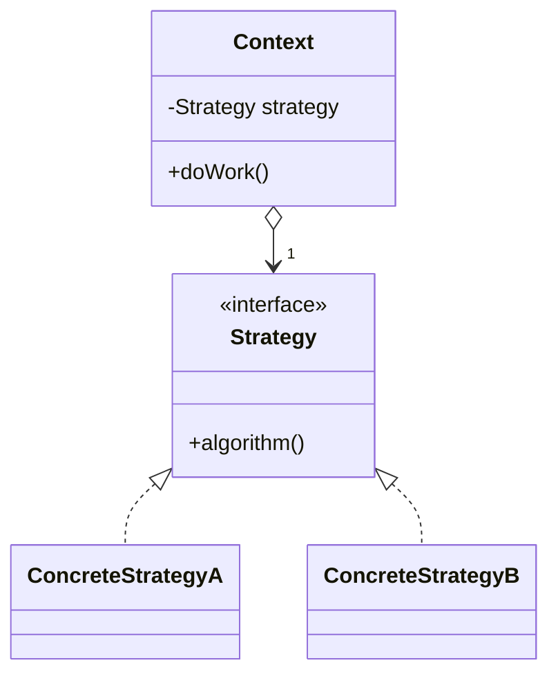
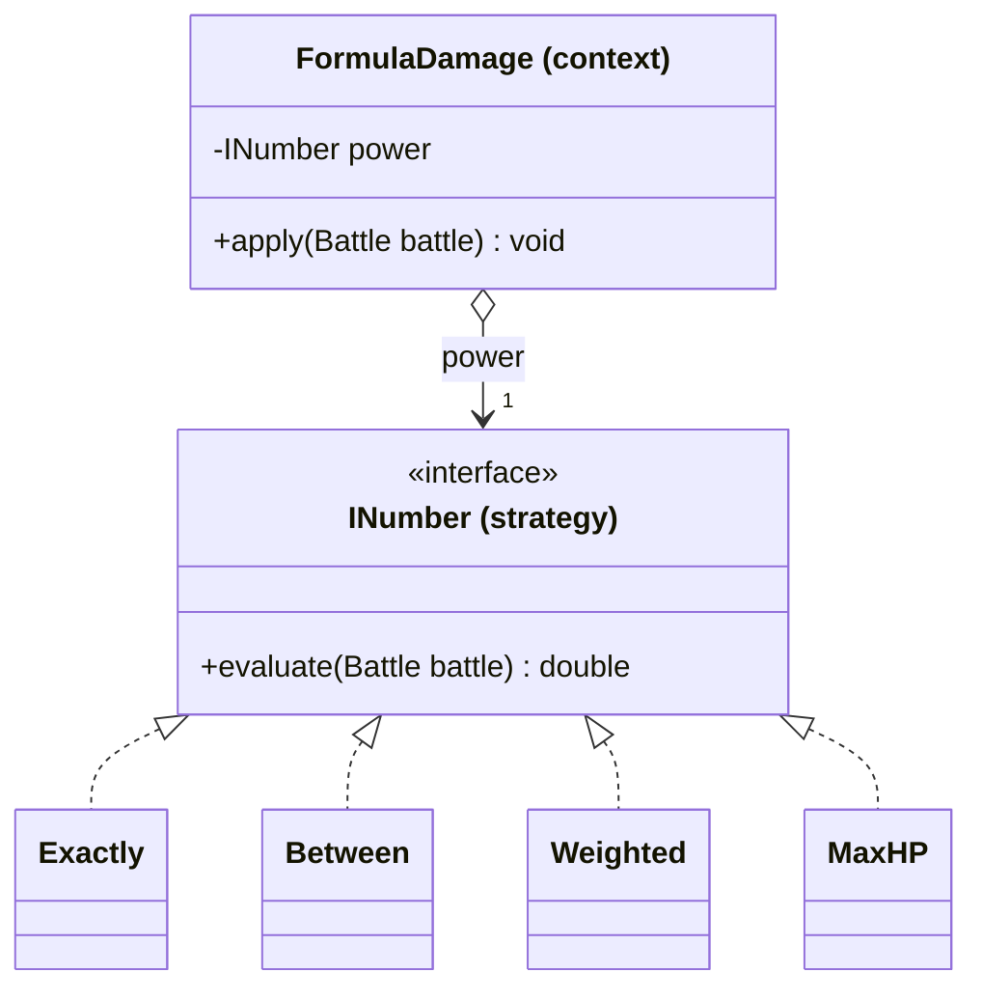
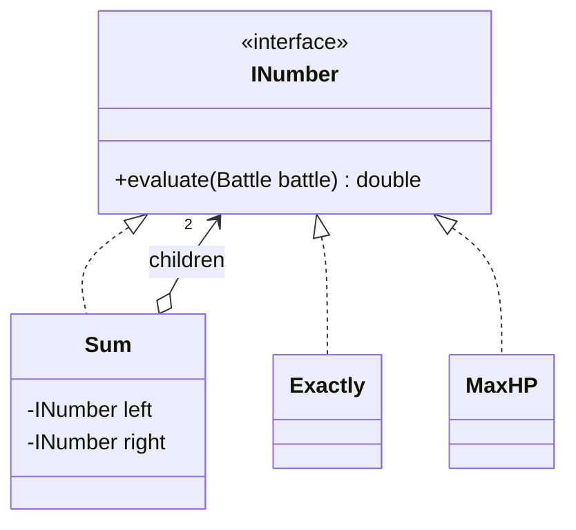
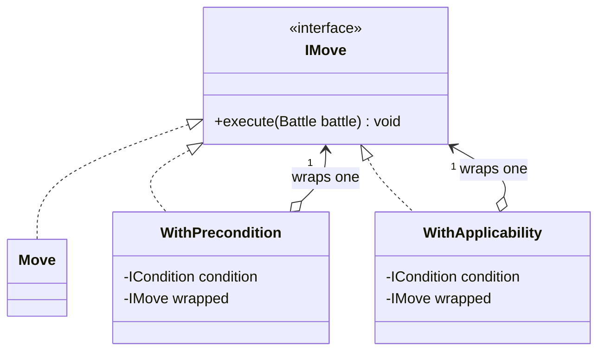
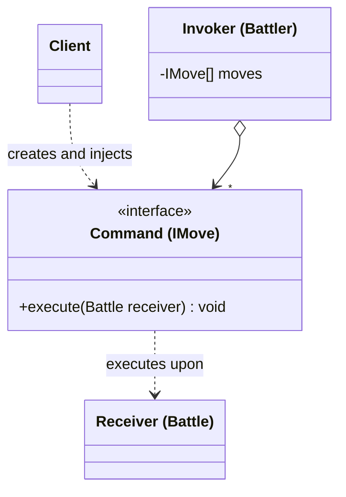
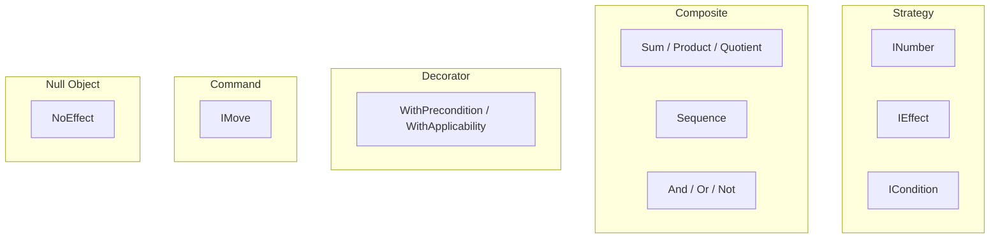
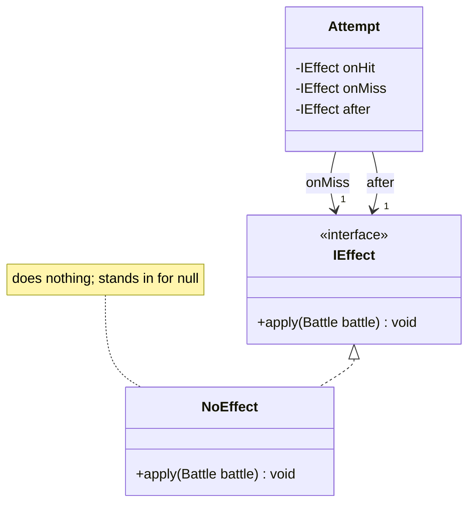

# Accidentally Used Design Patterns When Rebuilding Pokémon

> **Evidence record.** Verbatim transcript captured from the YouTube transcript panel
> with Playwright on 2026-11-12. The speaker is Christopher Okhravi; the words are his.
> Captions are auto-generated, so speech-recognition errors remain (obvious encoding
> corruption has been repaired). Diagrams are reconstructions of the whiteboard, drawn
> from the video frames — not screenshots.

| Field | Value |
|---|---|
| Channel | Christopher Okhravi |
| Video | Accidentally Used Design Patterns When Rebuilding Pokémon |
| URL | https://www.youtube.com/watch?v=f_0TFCNvCC4 |
| Duration | 37:59 |
| Captions | YouTube auto-generated (English) |
| Captured | 2026-11-12 |
| Method | Playwright (Chromium), YouTube transcript panel |

---

## 00:00:00 — Intro

- **0:00** — In the last video, we did a deep dive into the world of turn based battle games like, for example, Pokemon.
- **0:06** — We modeled it using object oriented programing and we came up with a really flexible solution that, as it turns out, actually is full of object oriented design patterns.
- **0:15** — But we never really talked about the design patterns, so that's what we're going to do today. We're going to look at the same design we did last time.
- **0:21** — But now I'm going to show which design patterns we used without even trying to use design patterns.
- **0:28** — If you haven't seen the previous video, I highly recommend you check it out.
- **0:31** — It's pretty interesting, but even if you haven't watched it, I'm certain you'll be able to understand everything that we're going to talk about in this video.
- **0:38** — Instead, Let's dive right in. Let's start with the basic strategy pattern.

## 00:00:40 — Strategy Pattern

*Reconstruction of the textbook shape he introduces at 00:40. The context holds one strategy behind the interface and calls it; the concrete algorithms are interchangeable.*

- **0:43** — Let's start with a formal definition from this classic book Design Patterns: Elements of reusable object oriented software.
- **0:50** — It's a great book, by the way.
- **0:52** — And if you're looking for books on design patterns, check out the links in the description. There's this book, which is the original resource. And then there's this book, which is a more pedagogical book.
- **1:00** — Links are in the description. Oh, and by the way, don't forget to grab a copy of my book. It's called The Object Oriented Way. Anyway, here's the formal definition.
- **1:08** — Strategy pattern defines a family of algorithms, encapsulates each one, and makes them interchangeable.
- **1:17** — Strategy lets the algorithm very independently from the clients that use it. The pattern essentially has three roles.
- **1:25** — First, there's the context. This is the class that uses a strategy. The one that needs to run the algorithm.
- **1:32** — It keeps a reference. to a strategy object. And then it delegates work to that strategy object. Second well there's the strategy.
- **1:41** — And this is the common interface that defines the signature of the algorithm.
- **1:44** — In other words, it defines how we can call the algorithm, of which there are many variations. All the concrete strategies implement this interface.
- **1:52** — Then finally we have the concrete strategies.
- **1:54** — These are the different algorithms, the different subtypes that the context can use, the different kinds of strategies that the context can use.
- **2:04** — To use this pattern.
- **2:05** — An object of a concrete subtype is dependency injected into the context, so that the context can use
- **2:12** — an algorithm without needing to know anything about how that algorithm works, or even which algorithm it is.
- **2:19** — By the way, if you want to dive deeper into design patterns, I've got a classic and extensive playlist on design patterns that you definitely should check out. Okay.
- **2:26** — But let's now have a look at where we can see the strategy pattern in the design that we looked at last time.

## 00:02:33 — Strategy Case 1: Numbers

*Reconstruction of Strategy Case 1 (02:33–05:00): `FormulaDamage` is the context, `INumber` the strategy, and the concrete numbers are interchangeable algorithms behind it.*

- **2:33** — First case of Strategy Pattern. Number calculation strategies. These are different strategies for getting to a number.
- **2:41** — All of these concrete classes here implement the interface INumber which demands that you define a method called evaluate, which takes a battle as input and returns a double as output.
- **2:54** — The problem we're trying to solve with this type is that sometimes we know that we need a number, but we can't specify exactly which number upfront.
- **3:01** — So instead, we specify a way of computing the number from a battle object.
- **3:07** — And the battle type is just a representation of the ongoing battle. Check out the previous video if you want more details on that. Now what are the subtypes of INumber?
- **3:14** — We can have constants like the type exactly. We can have random numbers like the types between and weighted.
- **3:21** — We can have numbers that are derived from the battle state like level or max HP.
- **3:26** — But we can also have combinators like Product and Sum that combine multiple numbers into a single number.
- **3:32** — This design essentially lets the number calculation vary independently from whoever is using the calculation. Strategy. Context.
- **3:40** — So in strategy pattern terms all these down here, right, all these types. These are concrete strategy implementations.
- **3:48** — And the abstraction the strategy is of course the INumber interface up here. So who plays the role of the context?
- **3:55** — Well anyone who has an INumber field and gets injected with an object instead of instantiating that object itself.
- **4:02** — One such example where we can see the context is the effect RestoreHP. This is an effect that can be used in a move.
- **4:10** — It takes a number and it takes a target.
- **4:13** — What this type does is that it restores the HP, the health of the target as much as the INumber evaluates to.
- **4:21** — This type RestoreHP fundamentally doesn't care how the number is computed. It just cares about being able to compute the number.
- **4:30** — Being given a strategy that it can use to compute a number. Another example is the attempt type combo.
- **4:39** — The combo type contains an INumber, which is used to determine how many times this combo should hit.
- **4:45** — In other words, how many times the effect and the animation should run. A combo fundamentally does not care how the number is computed.
- **4:56** — It just cares that it has a way to get to a number. It just needs a strategy. Let's go back to the effects.

## 00:05:00 — Strategy Case 2: Effects

- **5:02** — And let's look at the second case of strategy pattern. In this design. Effect application strategies. Effects are different ways to change the battle state.
- **5:11** — They're essentially different effects that a move can have. We can inflict status conditions like paralysis.
- **5:18** — Or we can deal damage as indirect damage or formula damage using the standard formula calculation. We can heal using restore HP.
- **5:26** — And we can even chain multiple effects with sequence. Or even express conditional effects with the condition effect.
- **5:33** — All of this lets the effect logic vary independently from whoever is triggering the effect.
- **5:41** — The strategy and the context.
- **5:43** — In strategy pattern terms, these are all concrete strategy implementations and the abstract strategy is of course the interface IEffect.
- **5:53** — And what is the context?
- **5:54** — Well, the context role is played by anyone with an IEffect field who gets injected with an IEffect object.
- **6:01** — Let's look at one such example. Let's go back to the attempts. The attempt type has three effect fields.
- **6:08** — One that is run if the attempt hits, one which is run if the attempt misses,
- **6:14** — and one which is run in the end afterwards, irrespective of whether the attempt was a hit or miss.
- **6:20** — When the attempt runs, it picks which effect to apply based on the accuracy, which is a condition.
- **6:28** — Attempt fundamentally does not care what the effects do or how they work.
- **6:35** — Attempt is only concerned about determining which combination of the three effects it should run, and then it just applies those effects.
- **6:43** — Should it run the hit effect and the after effect or should it run the miss effect and the after effect? For example. Back to effects.
- **6:50** — Another example where we can see effect strategies in action is in the condition effect.
- **6:55** — This is a particularly interesting case because the condition type is not just a context, but also a strategy itself.
- **7:03** — Sounds like a composite pattern. Anyone? We'll get back to this in a moment. The condition type takes two IEffect objects.
- **7:11** — One for when the condition passes and one for when the condition fails. What does the condition type do?
- **7:18** — Well, it simply checks the condition and then it applies the appropriate effect.
- **7:22** — Condition does not care what the effects do or how they are implemented.
- **7:27** — It just cares about choosing the first effect if the condition passes and the second effect if the condition fails.
- **7:35** — Then it just blindly applies the effect that has been chosen. That's it. Are those all the cases of strategy pattern? No. Let's look at the third case of strategy pattern.

## 00:07:38 — Strategy Case 3: Conditions

- **7:44** — Condition checking strategies. These are different ways to report true or false. Conditions are essentially impure predicates.
- **7:52** — We've defined the interface condition as a generic type and so implementers of this interface must specify a method called check which takes something of type T as input and produces a boolean as output.
- **8:04** — It maps from T to boolean. What can we do with this type? What can we express as subtypes of this type?
- **8:09** — Well, we can check whether a battler has a particular status condition with for example the type is paralyzed.
- **8:16** — Or we can check whether a battler has a particular element like fire or water, with has element.
- **8:22** — We can even have probabilistic conditions that report true or false with some probability.
- **8:27** — And then we can combine checks with the two types and and or or even invert the result of a check with not All this lets the checking logic vary independently from whoever needs to do the checking, from whoever needs the answer.
- **8:41** — So in strategy pattern terms, these concrete types here, these concrete types are all concrete strategies.
- **8:49** — And because we're using generics here, there's a generic strategy in terms of who plays the role of the abstract strategy.
- **8:55** — We also construct more specific abstract strategies.
- **8:59** — So we have the ICondition for battlers and the ICondition for battle and the ICondition for numbers.
- **9:06** — And so in terms of strategy pattern because we're using generics here we have multiple types that play the role of the strategy abstraction.
- **9:13** — Because we essentially have multiple cases of the strategy pattern. And so what is the context then?
- **9:18** — Well, the context is anyone who has an ICondition of any of these types and gets it injected.
- **9:24** — One example where condition checking strategies are used is in the move decorator with applicability.
- **9:32** — This class wraps a move with an applicability check to determine whether the move can be applied, or whether it cannot.
- **9:41** — It takes an ICondition of battler and it takes a move.
- **9:45** — And when we ask the with applicability move to execute, what it does is that before it executes the move, it checks if the condition passes and only if it passes does it execute the move.
- **9:56** — The with applicability type fundamentally does not care what condition we give it.
- **10:02** — It just runs the check method on the condition we give it to determine whether the move should be executed or not. It just needs a condition. It doesn't care which condition it gets or how that's implemented.
- **10:11** — Let's go back to the patterns.

## 00:10:12 — Strategy Conclusion

- **10:14** — So we've now seen three cases of the strategy pattern in this design.
- **10:18** — Number calculation strategies, effect application strategies and condition checking strategies.
- **10:25** — Are these all the cases of strategy pattern in this design? No, of course not. For example, moves get injected with attempts.
- **10:33** — So strategy pattern shows up everywhere.
- **10:36** — Generally, whenever you see a type, a context, that's dependency injected with a supertype, the strategy, then you can often think of that as a case of the strategy pattern.
- **10:47** — Let's move on to the next pattern, the composite pattern. Let's look at the formal definition of the composite pattern.

## 00:10:49 — Composite Pattern

*Reconstruction of the Composite shape (10:49–12:31): `Sum` is itself an `INumber` and holds `INumber`s, so a tree of numbers can be treated exactly like a leaf.*

- **10:53** — Composite pattern composes objects into tree structures to represent part whole hierarchies.
- **11:01** — Composite lets clients treat individual objects and compositions of objects uniformly.
- **11:08** — In simpler terms, we want to build complex things from simple pieces, and we want to be able to treat both the simple pieces and the complex things the same way.
- **11:19** — Essentially, composite pattern allows us to represent tree structures, right?
- **11:26** — The pattern has three essential roles. First, we have the component. This is the interface that both simple and complex objects share.
- **11:36** — It's the thing that allows us to treat individual objects and compositions of objects uniformly, to treat them as if they were the same type.
- **11:45** — Then we have the leaves.
- **11:46** — And from these we make the simple objects that don't contain other objects. And finally we have the composite types.
- **11:53** — And from these types we make the complex objects that contain other objects. The compositions.
- **11:59** — And the key here is of course that the composite types not only are components, but also have components.
- **12:10** — The composite type is a component, But also has components. Because think about tree structures right.
- **12:17** — Every node that's not a leaf both is a node and has references to other nodes.
- **12:23** — Again, if you want to dive deeper into specific design patterns check out my other playlist. So where do we find the composite pattern in this design?

## 00:12:31 — Composite Case 1: Numbers

- **12:31** — Let's look at the first case.
- **12:33** — The first case of composite pattern that I want to show you is numeric expressions.
- **12:38** — These numbers, they are essentially numerical calculations represented as trees.
- **12:43** — We've already looked at some of these classes right so we know that we can represent constants with exactly random numbers with between and weighted and we can have battle dependent numbers like max HP and level.
- **12:52** — But we can also combine numbers using types like product, sum or quotient.
- **13:01** — And we can think of a bunch of other types of course. Product takes two number objects and when product is evaluated,
- **13:10** — when we ask it to to evaluate what the number is, then it will evaluate those two number objects,
- **13:17** — and then it will multiply the result into one number and return that number. And sum does the same thing, but it adds the numbers together.
- **13:25** — And quotient does the same thing, but it divides one number by the other, and so forth and so forth. And of course, we could have more composites.
- **13:33** — We could have one called Max, which returns the biggest of two numbers. And it doesn't matter where the numbers come from.
- **13:40** — You know, maybe one number is a level and one is a max HP. It could be any kind of INumber.
- **13:45** — Or we could have another composite, which is a conditional number that checks a condition and returns one number if the condition is true and the other number if the condition is false.
- **13:55** — Clearly this is a case of the composite pattern. All of these concrete number classes implement the same interface.
- **14:03** — The component interface.
- **14:05** — But since some numbers not only are numbers, but also contain numbers, then we can nest these compositions as deeply as we want.
- **14:16** — In composition pattern terms the interface INumber is of course the component and then simple numbers like exactly, between and max HP, all of these down here, these are the leaves.
- **14:27** — Why are they leaves?
- **14:28** — Well they are leaves because they don't contain any other number objects.
- **14:32** — Product, sum and quotient, and max and condition that we talked about before they however they are composites because they do contain other number objects.
- **14:41** — And as we saw in the last video, it's actually really easy to express quite complex numbers. Let's look at one example.
- **14:47** — Here in one of the code examples from last time, we take the product of the max hp of the attacker and the constant 0.5, meaning that we end up with half of the attacker's max HP.
- **14:59** — Right? And that is a number. It's a component, but it's a composite number. It's a composition. But we can express anything with these numbers.
- **15:08** — Right.
- **15:08** — There's another move called pain split for example and that move sets the HP of both players to the average of the two player's current HP.
- **15:16** — What I mean is that it splits the current HP of both players, the total HP of both of them. It splits it between them and hence the name pain split right.
- **15:25** — That too would be really simple to express as a composite number. We would instantiate a quotient, and then what would we pass it?
- **15:31** — Well, as the dividend we would pass a sum object containing the current HP of the attacker and the current HP of the defender.
- **15:42** — Then, as the divisor to the quotient, we would pass a constant object containing the number two. Simple.
- **15:49** — And that's the power of tree structures. That's the power of the composite pattern. Let's look at another case.
- **15:55** — Here's the second case of the composite pattern that I want to show you. Effect sequences and effect conditions.

## 00:15:56 — Composite Case 2: Effects

- **16:03** — Remember, effects are the things that actually happen during a move. We've already looked at these, right.
- **16:08** — You can have simple effects like direct damage or restore HP or formula damage or paralysis.
- **16:13** — But then we can also have effect compositions like sequence, which lets us apply multiple effects in order.
- **16:21** — And we can have condition effects, which lets us apply either one effect or another depending on some condition.
- **16:29** — So sequence contains any number of effects and condition contains two effects.
- **16:36** — One for when the condition is true and one for when the condition is false.
- **16:39** — And notice how sequence and condition not only are effects but also contain effects.
- **16:48** — So this is another case of the composite pattern.
- **16:50** — And since the composites the composites and the leaves can be treated uniformly, can all be treated as effects, then we can nest sequences and conditions as deeply as we want.
- **17:02** — So in composite pattern terms, the interface IEffect is of course the component abstraction.
- **17:07** — And then simple effects like no effect, formula damage, faint, drain and so forth. These down here these down here, they are all leaves.
- **17:17** — They don't contain any effects. They just are effects.
- **17:21** — But sequence and condition they are the composites because they not only are effects but they also contain effects.
- **17:29** — Let's look at an example of effect composites in use. Have a look at this second example called body slam.
- **17:35** — The move body slam first deals damage, formula damage, and then has a 30% chance to also paralyze the defender.
- **17:45** — So the effect of this move, the effect of this move is actually a composite effect.
- **17:50** — It is a sequence, it's a sequence that starts with formula damage followed by a conditional effect
- **17:58** — that contains the paralysis effect, which is only applied if the condition is passed, which was 30% of the time.
- **18:06** — So we've got paralysis within a condition alongside a formula damage inside a sequence.
- **18:15** — So in this case we actually have a composite in a composite. Here's the third case of composite pattern that I want to show you. Logical conditions.

## 00:18:19 — Composite Case 3: Conditions

- **18:24** — Remember conditions are roughly predicates right. Things that evaluate to true or false.
- **18:28** — We've already talked about simple conditions like, you know, is paralyzed or probability and we've also mentioned that you can combine conditions with and, or and we can invert them with not.
- **18:40** — What we didn't mention is that that makes this another case of the composite pattern.
- **18:46** — The class and is a condition but also has two conditions. It takes two condition objects.
- **18:54** — When we call check on the condition, on the condition and, it calls, check on the two underlying conditions and then combines their result with logical and.
- **19:05** — In other words, the method check, in and, returns true if both of the inner conditions, that it contains, If both of the inner conditions check methods if those return true.
- **19:17** — And or does the same thing, but for logical or you know, if either of the inner conditions are true.
- **19:22** — And not simply contains one condition and inverts the result of that inner condition.
- **19:27** — And all of those conditions are conditions but also contain conditions. So they are composites.
- **19:34** — In composite pattern terms, ICondition is the component.
- **19:38** — Simple conditions like probability are leaves And the composites, they're the conditions that contain other conditions like and or and not.
- **19:46** — Let's take an example of composite conditions in action.
- **19:50** — The move thunder wave can only hit ground battlers that aren't already paralyzed.
- **19:56** — We can express the first part of that condition by instantiating a not condition and passing the has element condition to which we pass the ground element.
- **20:08** — And the second part can also be expressed as a not condition.
- **20:11** — A not condition but this time we pass the is paralyzed condition.
- **20:16** — And in this particular example, we're also using the for type to lift the battler condition up to the level of a battle condition,
- **20:25** — in order to specify who this condition applies to, and in this case it applies to the defender.
- **20:30** — If you're intrigued by this idea of lifting using the for type, definitely check out the previous video.
- **20:35** — But we could have expressed the idea of being non paralyzed and non ground as a single condition.
- **20:42** — We would have just combined them using an and.
- **20:44** — But we didn't put them in one condition in this example, because we wanted to use one part of the condition as a precondition and the other part of the condition as an applicability condition.
- **20:53** — More about that in the previous video if you're interested. So the composite pattern shows up a lot in this code.

## 00:21:00 — Composite Conclusion

- **21:00** — And generally whenever you see a type that both is of a supertype and has elements of that same supertype, then you're probably looking at a case of the composite pattern.
- **21:11** — By the way, if you like the kind of stuff that we're talking about here, then you will definitely like my book. It's called The Object Oriented Way. There's a link in the description, so definitely check it out.

## 00:21:20 — Decorator Pattern

*Reconstruction of the Decorator shape (21:20–23:36). The wrapper has the same interface as the thing it wraps and holds exactly one component — the linked-list contrast with Composite’s tree.*

- **21:20** — Okay.
- **21:21** — Let's move on to the next pattern, which is called the decorator pattern. Let's start with a formal definition.
- **21:27** — The decorator pattern attaches additional responsibilities to an object dynamically.
- **21:33** — Decorators provide a flexible alternative to subclassing for extending functionality.
- **21:40** — In other words, we want to add behavior to an object without changing the object itself. So how do we do that?
- **21:47** — Well, we wrap the object in another object that adds the new behavior and delegates to the inner object when necessary.
- **21:55** — And since the wrapper, the wrapper of the object has the same interface as the thing it wraps, we can use the two interchangeably.
- **22:01** — And of course we can wrap an arbitrary number of times, right? Turtles within turtles within turtles. The pattern has essentially four roles.
- **22:10** — First, we have the component.
- **22:12** — This is the supertype that both plain objects and decorated objects share. Then we have the concrete component.
- **22:20** — This is the type of the basic object that we want to add behavior to. The objects that we want to decorate. Then we have the decorator.
- **22:28** — And this is an abstract wrapper that implements the component interface and holds a reference to another component. Right.
- **22:35** — The decorator is a component and has a component.
- **22:39** — Now, as far as I understand it, it's very common to just skip this abstract decorator step entirely and just jump directly to the last step to the last role, which are the concrete decorators.
- **22:50** — These are the actual wrappers, the actual decorators that add specific behavior before or after delegating to the wrapped component.
- **23:00** — And just like with the composite pattern, you know the concrete decorator both is a component and has a component.
- **23:08** — And you'd be forgiven for thinking that the decorator pattern looks very similar to the composite pattern. And yes, they do.
- **23:15** — And the only really key difference is that decorators have a single component while composites have multiple components.
- **23:22** — So with decorators we build essentially linked lists. And with composites we build tree structures.
- **23:28** — But check out my design pattern playlist if you want to dig more into that. So do we have decorators in this design that we're looking at? Yes, we do.

## 00:23:36 — Decorator Case: Moves

- **23:36** — Here's the case I want to talk about. Move decorators.
- **23:39** — you might have already suspected that this was the case because during the last video, we even explained these as that they decorated moves. What's the problem we're trying to solve here?
- **23:47** — Well, some moves can only be used under certain conditions.
- **23:50** — Some moves might, for example, not affect certain types of defenders, or they might not be usable if the attacker don't satisfy some criteria.
- **23:58** — The reasons can be arbitrary, right?
- **24:00** — So by decorating moves we can add such gating behavior without actually having to change the move type itself.
- **24:08** — In decorator pattern terms, IMove is the component. And the basic move class down here that's the concrete component.
- **24:17** — And then the types with precondition and with applicability they are the concrete decorators.
- **24:24** — So again we are skipping this step of the abstract decorator.
- **24:27** — The two concrete decorators are IMoves, but they also contain an IMove that they delegate to after having added their own logic.
- **24:38** — More specifically, the type with precondition wraps, a move and adds a battle condition check.
- **24:44** — In other words, it takes a battle condition and it takes a move.
- **24:48** — And when you try to execute a move decorated with a precondition, the decorator first checks if the condition passes.
- **24:56** — Only if it does, does it execute the move.
- **24:59** — But if the condition fails, then it skips executing the move and instead prints a message like. But it failed, right? Because the move failed.
- **25:07** — And similarly on this side. The with applicability decorator essentially does the same thing.
- **25:12** — But this time for battler conditions and with a slightly different message. The really interesting part here is that you can nest these decorators.
- **25:19** — You can wrap a move with any number of applicability and precondition decorators in any arbitrary order.
- **25:26** — But at the bottom, at the bottom, you will have to supply an actual move. So it's not turtles all the way down.
- **25:33** — It's decorators inside decorators inside decorators until we eventually get to a concrete component. This is essentially recursion for objects.
- **25:41** — Do you remember the move thunder wave? Let's go back to it.
- **25:43** — This move is actually wrapped with a precondition decorator, which is then wrapped with an applicability decorator.
- **25:52** — And since we're calling objects from the outside, they're applied in reverse.
- **25:56** — First we check the applicability condition, then we check the precondition, and then we end up with the move.
- **26:00** — So first the applicability decorator checks that the target isn't a ground battler.
- **26:05** — And then the precondition decorator checks that the target isn't already paralyzed.
- **26:09** — And only if both of these conditions hold do we end up executing the move. So that's an example of the move decorators in action. Back to the patterns.

## 00:26:16 — Decorator Conclusion

- **26:17** — So whenever you see a type that both is of a supertype but also has a field of that same supertype, you're probably looking at a decorator.
- **26:26** — But but but wait, again then we say that about composite pattern as well.
- **26:30** — Yes. But with composite pattern the composites wrap multiple components. And in decorator pattern we decorate a single component.
- **26:39** — So while composite builds tree structures, decorators build linked lists.
- **26:45** — Decorators build chains of responsibility where each decorator does its thing and then passes control to the next one in the chain.
- **26:52** — Let's move on to the next pattern, the command pattern. And let's start again with a formal definition from this book.

## 00:26:53 — Command Pattern

*Reconstruction of the Command shape (26:53–29:22). He notes that the textbook client is skipped: the invoker must not create commands, they are injected into it. In the game the invoker is the `Battler`, and the receiver is the `Battle` passed to `execute`.*

- **26:59** — The command pattern encapsulates a request as an object, thereby letting you parameterize clients with different requests, queue or log requests, and support undoable operations.
- **27:12** — In simpler terms, we want to turn actions into objects.
- **27:16** — Instead of calling a method directly we create an object that represents the action.
- **27:22** — Then we can pass that object around, store it, and then execute it later. Sometimes this even allows us to implement undo functionality.
- **27:29** — That's not something we've looked at in this case.
- **27:31** — But essentially we move from methods to objects, from verbs to nouns. The pattern has five essential roles.
- **27:40** — First, we have the command. This is the general interface that all command objects share. It's the supertype that defines the signature of the execution method.
- **27:49** — The key method that all commands have to have. The method that is the method that we actually want to execute. Then of course we have the concrete commands.
- **27:57** — These are the specific actions, the specific commands, the actual algorithms we want. And these all of course implement the command interface.
- **28:05** — Then we have the receiver.
- **28:08** — This is the type of the object that actually does the work when the concrete command executes. When the command executes.
- **28:16** — The object that the command is executed upon. So a command is executed upon a receiver. It's the one doing the actual work.
- **28:24** — Or you can think about it as the object that the command delegates to. Then finally we have the invoker.
- **28:30** — And the invoker is the type that has commands and calls the execute method on a command.
- **28:36** — It's the thing that we can interact with in order to interact with the commands. It's like the remote control.
- **28:42** — So the invoker is like the remote control and the receiver is like the device.
- **28:46** — Strictly speaking, the pattern also includes a role called client that creates commands, concrete commands and gives them the receiver.
- **28:55** — But we're skipping that type here for simplicity.
- **28:57** — And the important thing to remember when skipping that type is that the invoker is not the one who creates commands.
- **29:06** — The commands must be injected into the invoker. The invoker is like the context where commands are strategies.
- **29:14** — So do we have commands in our design here? Absolutely. Not exactly by the book, but definitely in spirit.

## 00:29:22 — Command Case: Moves

- **29:22** — Here's the case I want to talk about. Moves as commands. Think about it. Moves are actions that can be performed in a battle.
- **29:29** — Each move encapsulates everything needed to execute that action.
- **29:34** — The animation, the effects, the accuracy checks, the repetitions, conditions, all of it. And to run the move, we simply call execute on it.
- **29:42** — So in command pattern terms, IMove is the command interface.
- **29:46** — And the concrete commands, well that's move, with precondition and with applicability. They all implement the execute method in slightly different ways.
- **29:54** — Now who's the receiver? Who's the device that we're controlling? That is the battle object because that's what the moves operate upon.
- **30:02** — That's what the moves delegate to. And specifically it's what their effects delegate to. Right. But by proxy, that's what the moves delegate to. But what about the invoker?
- **30:10** — What about the remote control? Who is the remote control?
- **30:13** — Well, arguably, since the invoker is the one that has the commands and calls execute on them, it's probably the battler.
- **30:20** — In the case of the game, Pokemon, a Pokemon learns a move and the move is stored on the Pokemon. And so the Pokemon is the invoker.
- **30:28** — And again, the invoker must not be the one instantiating the moves.
- **30:32** — So the moves are injected into the battlers rather than created by them. The moves are injected into the Pokemon.
- **30:38** — Now, I have to say that this implementation of commands pattern is of course not exactly following the letter of the law, but it definitely follows the spirit of the law. So what's the problem?
- **30:46** — Well, in the textbook definition of the pattern the command has a reference to the receiver. But in our case our commands have to be passed the receiver.
- **30:55** — Remember we said the battle is the receiver. And our commands have to be passed the battle. When we execute.
- **31:01** — So when we call execute on a move on a command, then we have to pass in a battle the receiver. The moves themselves don't have a reference to the battle.
- **31:09** — They don't have a reference themselves to the receiver. Could we associate the commands with the receiver? Could we give the receiver to the actual commands?
- **31:16** — Of course.
- **31:17** — And if you think about that for a moment, you'll realize that this will probably put us on a trajectory where we will probably end up introducing the factory method pattern.
- **31:25** — Because we might end up with battlers that don't have moves, but have move factories that can create moves associated with that battle.
- **31:32** — Anyway, let's get back to the topic.
- **31:35** — The power of command pattern is that moves become first class citizens, first class objects. You can store them in a list.

## 00:31:36 — Command Conclusion

- **31:43** — You can pass them around as parameters. You can build composite commands or you can decorate your commands.
- **31:49** — We can, for example, create a move queue that stores moves to execute later. We can associate a move with power points and so forth and so forth.
- **31:56** — All of that becomes possible because we're turning an action into an object instead of a method, we turn it into a noun instead of a verb.
- **32:03** — So whenever you see an interface with an execute or do or run method, you might be looking at the command pattern.
- **32:12** — And the key idea was that we turn actions into data, that we turn verbs into nouns so that we can manipulate them and pass them around just like any other object.

## 00:32:20 — Mixing Patterns

*Reconstruction of “Mixing Patterns” (32:20–32:46). The same small set of types plays several roles at once; the patterns are names for what the composition already does.*

- **32:20** — By the way, I hope you've noticed how we can mix multiple patterns at the same time.
- **32:24** — With moves we were essentially using the command pattern and the decorator pattern at the same time.
- **32:29** — And as we've already seen inside each command, inside each move, we find multiple cases of both the composite pattern and the strategy pattern.
- **32:38** — So there's no reason to religiously stick to a single pattern.
- **32:41** — We just use whatever modeling techniques help us effectively solve our actual problems. I've got one final bonus pattern for you.

## 00:32:46 — Null Object Pattern

*Reconstruction of the Null Object case (32:46–36:16): `NoEffect` is a real `IEffect`, so `onMiss` and `after` never hold null and callers never need a special case.*

- **32:49** — The null object pattern. This one isn't from the Gang of Four book from this classic book. But it shows up in this design and it's pretty useful.
- **32:57** — So I think it's worth mentioning. The idea is simple.
- **32:59** — Instead of using null to represent the absence of something, we use a real object that does nothing.
- **33:06** — This eliminates null checks throughout the code because we can blindly delegate to our objects instead of having to check whether we have null or whether we have an object.
- **33:16** — The pattern has the same structure as the strategy pattern.
- **33:19** — The point is just that we have a strategy which is a null strategy that does nothing and can be used instead of using null.
- **33:27** — Here's the case of the null object pattern that I want to talk about. The no effect effect We've already talked about effects.
- **33:34** — Effects change the battle state.
- **33:36** — They take battle as input and then they mutate that battle state to apply its effect. But sometimes we don't actually want anything to happen.
- **33:43** — But maybe we still want an effect variable, We still want a variable of type IEffect. because other times we do want something to happen.
- **33:51** — I'll explain why we might want this variable in just a second.
- **33:54** — But so instead of using null, which forces us to do null checking everywhere, we can use the no effect type.
- **34:01** — It implements IEffect just like any other effect, but it's apply method when you call, apply and pass it a battle, it's apply method is completely empty.
- **34:11** — When you call apply on no effect, nothing happens. How could this be useful? Well, here's an example. The conditional effect.

## 00:34:14 — Null Object Case: Effects

- **34:19** — The condition effect has two effect fields.
- **34:22** — One of the effects is run when the condition inside the conditional effect is true, and the other effect is run when the condition inside the conditional effect is false.
- **34:31** — But just like with regular if statements, sometimes we want to express just an if with no else branch, and sometimes we want both an if branch and an else branch.
- **34:41** — So in other words the else branch the fail effect should be optional for the conditional effect type. But what should this parameter default to?
- **34:50** — Should it default to null?
- **34:51** — No, because that means that we would have to do null checking before calling apply on the effect because we're not sure whether we actually have an effect or if we have null.
- **35:02** — Instead, we should default to an instance of the no effect class.
- **35:07** — Because no effect handles the do nothing case by simply doing nothing when it's applied. Here's another example of when we are using the no effect effect.
- **35:16** — Attempts. The attempt class has three effect fields.
- **35:20** — One effect, which is run if the attempt hits, and one effect, which is run if the attempt misses, and one effect, which is run in either case after it either hit or missed.
- **35:30** — So while all moves must specify what happens if the attempt hits the miss effect and the after effect, these two are optional.
- **35:38** — So why do we default these optional parameters to? You guessed it, an instance of the no effect class.
- **35:45** — because that no effect class handles the do nothing case gracefully without us having to do null checking.
- **35:52** — So the power of the null object pattern is that it eliminates special cases.
- **35:57** — We treat the absence of behavior exactly the same as the presence of behavior. No branching, no null checks.
- **36:05** — The code is straighter and simpler. This is very much in the spirit of object oriented programing. We just call the method and let the object decide what to do.
- **36:14** — Even if that object decides to do nothing.

## 00:36:16 — Conclusion

- **36:16** — All right, that's it for the design patterns in this model that I wanted to talk about, we've seen the strategy pattern, the composite pattern,
- **36:23** — the decorator pattern, the command pattern, and the null object pattern, all working together to create a flexible, composable model of battle moves.
- **36:33** — And I think it's pretty interesting that we ended up with so many design patterns in our model, even though I, I promise, did not deliberately try to use them at all.
- **36:44** — I just tried to create useful abstractions, effective abstractions.
- **36:48** — And generally I got to say that I think what happened here is actually very, very common.
- **36:54** — When we strive to write readable, flexible, testable, maintainable, object oriented code, we simply end up using
- **37:01** — a few of these key design patterns, whether we want to or not, and whether we know their names or not.
- **37:07** — Because these patterns are fundamental to the very idea, to the very fabric of object oriented programing.
- **37:14** — And that's why my book, The Object Oriented Way, does not discuss all design patterns.
- **37:19** — It doesn't even discuss all of the classic Gang of Four patterns, because I belong to the group of people who actually think that some of these patterns are anti-patterns.
- **37:29** — Instead, in my book, The Object Oriented Way, I discuss what I believe are the few fundamental design patterns that truly keep showing up again and again and again, regardless of whether you want them to or not.
- **37:41** — So check out my book. There's a link in the description. Don't miss it.
- **37:44** — Oh, and in addition to my book, I'd highly recommend these two books if you want to get in more into design patterns. This is the original source and this is a more pedagogical book.
- **37:53** — Links are in the description. And again I've got a playlist on Design Patterns. Okay, I'll see you in the next one.

---

Captured 2026-11-12. Related: [CONTEXT.md](CONTEXT.md), [Rebuilding Pokémon with Object Oriented Programming]( TRANSCRIPT-01-rebuilding-pokemon-with-oop.md ).
